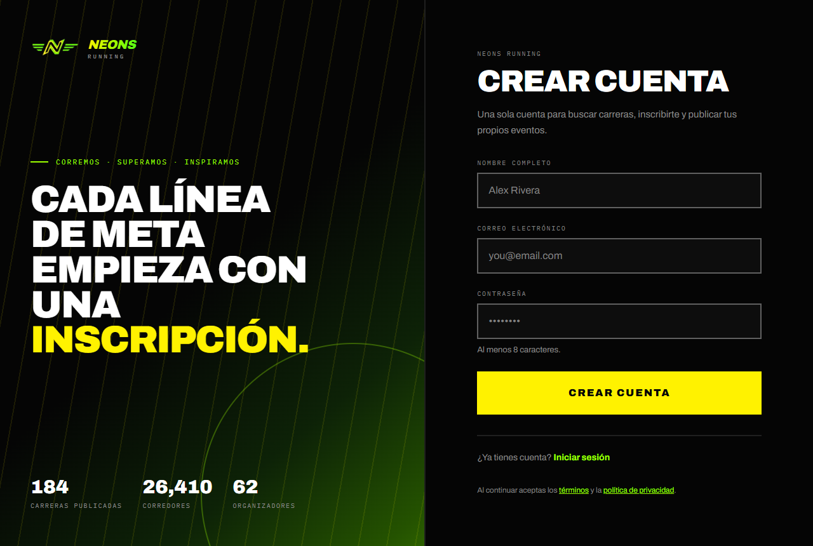
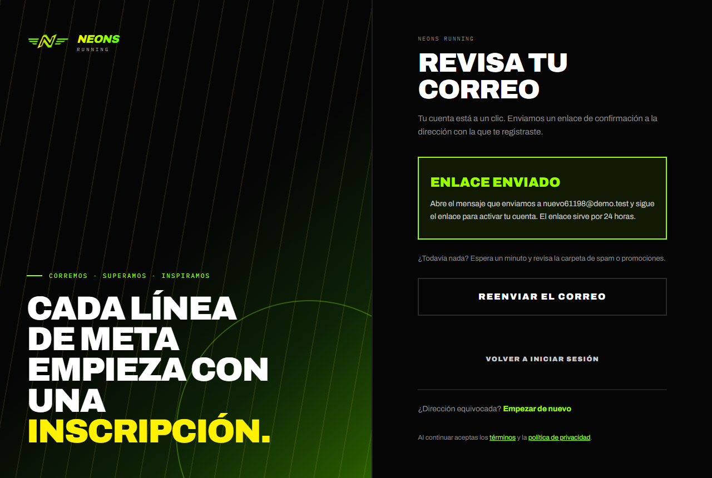
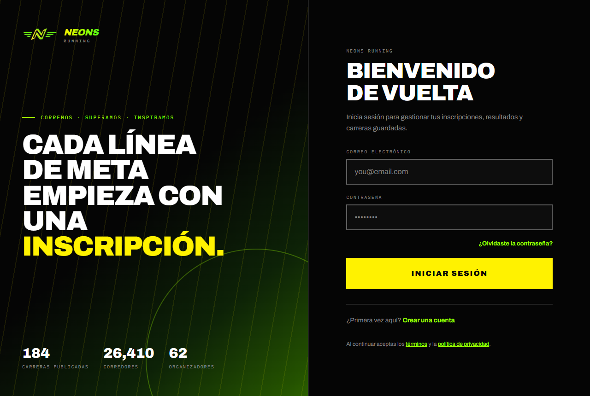
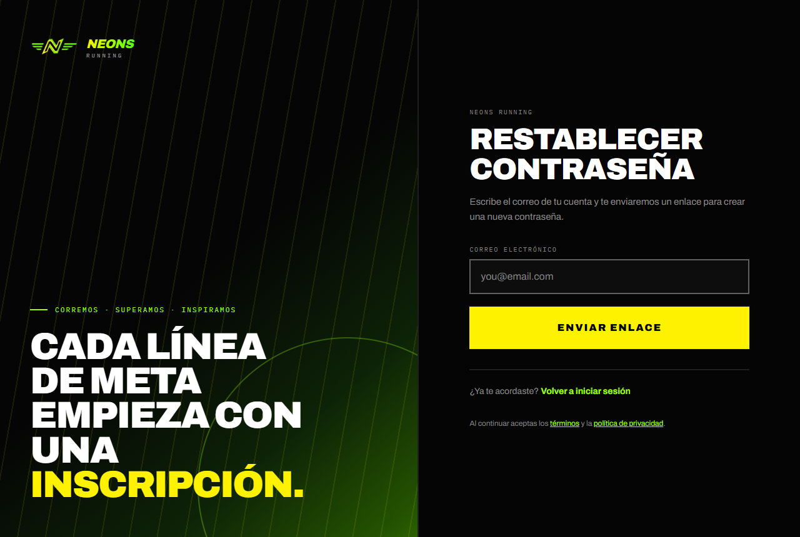
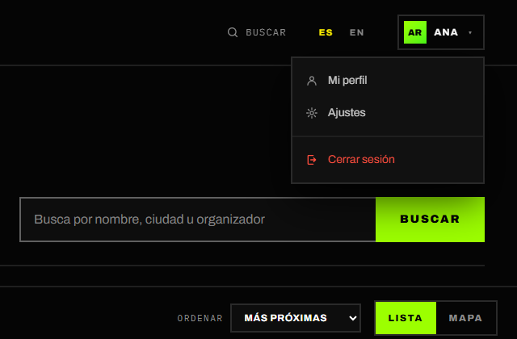

# 1. Primeros pasos

[← Volver al índice](README.md)

Esta sección vale para todos: cómo crear una cuenta, entrar, recuperar la
contraseña y moverse por la aplicación.

## 1.1 Crear una cuenta

**Para qué sirve:** para inscribirte en carreras, guardar tus favoritas y tener
tu perfil con tus resultados. Navegar y ver carreras no necesita cuenta.

**Dónde:** botón **Crear cuenta** arriba a la derecha (`/signup`).

### Con tu correo

1. Escribe tu **Nombre completo**. Es el nombre que se imprime en tu dorsal.
2. Escribe tu **Correo electrónico**.
3. Escribe una **Contraseña** de al menos 8 caracteres.
4. Pulsa **Crear cuenta**.
5. Verás la pantalla **Revisa tu correo**. Abre el mensaje que te enviamos y
   pulsa el enlace. **El enlace sirve por 24 horas.**
6. El enlace abre la pantalla **Confirma que eres tú**. Pulsa **Continuar**.
   Tu cuenta queda activa y con la sesión iniciada.

¿No te llegó el correo? Espera un minuto, revisa la carpeta de spam o
promociones, y pulsa **Reenviar el correo** (se activa tras una cuenta
regresiva). Solo funciona el enlace más reciente.

### Con Google

1. Pulsa **Continuar con Google**.
2. Elige tu cuenta de Google y acepta.
3. Vuelves a NEONS RUNNING con la sesión iniciada; no hace falta confirmar el
   correo.

> Al crear la cuenta aceptas los **términos** y la **política de
> privacidad**, enlazados debajo del formulario.

> **🛠 Nota técnica:** la autenticación es de Supabase Auth. Toda cuenta nueva
> nace como `account_type = 'runner'`; el registro con Google rellena el nombre
> desde el perfil de Google y nunca puede crear un organizador. Los enlaces de
> correo (`token_hash`) pasan por `/auth/confirm` y se detienen en
> `/confirm-link`, donde el usuario pulsa **Continuar** antes de gastar el
> enlace; así un escáner de correo que abra el enlace no lo consume. El
> callback de Google es `/auth/callback`.

## 1.2 Iniciar sesión

**Dónde:** **Iniciar sesión** (`/login`).

1. Escribe tu **Correo electrónico** y tu **Contraseña**, o pulsa
   **Continuar con Google**.
2. Pulsa **Iniciar sesión**.
3. Entras a tu perfil, o a la página que intentabas abrir (por ejemplo, la
   inscripción de una carrera).

| Mensaje | Qué significa |
| --- | --- |
| *Ese correo y contraseña no coinciden con ninguna cuenta.* | Revisa lo que escribiste o recupera la contraseña. |
| *Confirma tu correo primero — busca el enlace en tu bandeja.* | Todavía no has pulsado el enlace de confirmación. |
| *Demasiados intentos. Espera un minuto y vuelve a probar.* | Protección contra intentos repetidos. |

**Cerrar sesión:** abre el menú de tu cuenta (tu foto o tus iniciales, arriba a
la derecha) y pulsa **Cerrar sesión**.

## 1.3 Recuperar la contraseña

**Dónde:** en **Iniciar sesión**, el enlace **¿Olvidaste la contraseña?**
(`/forgot-password`).

1. Escribe el correo de tu cuenta y pulsa **Enviar enlace**.
2. Abre el correo y pulsa el enlace. **Caduca en 30 minutos.**
3. En **Confirma que eres tú**, pulsa **Continuar a la contraseña nueva**.
4. Escribe la **Nueva contraseña** dos veces y pulsa **Guardar contraseña**.
   Tu sesión sigue abierta en ese dispositivo.

> Por seguridad, la pantalla siempre dice que el enlace "va en camino", exista
> o no una cuenta con ese correo.

> **🛠 Nota técnica:** la página `/reset-password` también se puede abrir con
> la sesión iniciada pero sin enlace de recuperación. En ese caso pide la
> **Contraseña actual**. La sesión abierta por un enlace de recuperación queda
> exenta durante 60 minutos (`RECOVERY_WINDOW_SECONDS` en
> `lib/auth/routes.ts`), leyendo el claim `amr` del token.

## 1.4 Moverse por la aplicación

**En computadora**, la barra superior tiene:

- **Carreras** (`/events`) y **Nosotros** (`/about`).
- El selector de idioma (**ES / EN**).
- Con la sesión iniciada, el menú de tu cuenta: **Mi perfil**, **Ajustes**,
  **Cerrar sesión** y, según tu rol, **Panel de organizador**, **Revisión de
  Pagos** y **Moderación de Eventos**.

**En el teléfono**, una barra inferior con **Inicio**, **Carreras**,
**Nosotros** y **Perfil** (o **Iniciar sesión**). El selector de idioma está al
pie de la página.

### Idioma

La aplicación está en **español** (por defecto) e **inglés**. Cambia el idioma
con el selector **ES / EN**. Los correos de una inscripción llegan en el idioma
en el que te inscribiste.

> **🛠 Nota técnica:** el idioma va en la ruta (`/` = español, `/en/…` =
> inglés), resuelto por `proxy.ts`. Los textos están en
> `dictionaries/es.json` y `dictionaries/en.json`; `npm run check:i18n`
> comprueba que ambos tengan las mismas claves. Las secciones **Resultados** y
> **Comunidad** existen (`/results`, `/community`) pero están ocultas en el menú
> hasta una próxima versión.

---

Siguiente: [Guía del corredor →](02-corredor.md)
