# 2. Guía del corredor

[← Volver al índice](README.md)

Un **corredor** es cualquier persona con una cuenta en NEONS RUNNING. Si
todavía no tienes cuenta, empieza por [Primeros pasos](01-primeros-pasos.md).

## Resumen: qué puede hacer un corredor

| Tarea | Dónde |
| --- | --- |
| [Buscar carreras](#21-buscar-carreras) | **Carreras** (`/events`) |
| [Ver el detalle de una carrera](#22-ver-el-detalle-de-una-carrera) | `/events/<carrera>` |
| [Guardar carreras favoritas](#23-guardar-carreras) | Corazón en cada carrera |
| [Inscribirse y pagar](#24-inscribirse-en-una-carrera) | **Inscribirme ahora** |
| [Pagar con ATH Móvil](#25-pagar-con-ath-móvil) | Paso 4 de la inscripción |
| [Consultar tu perfil e inscripciones](#26-tu-perfil) | **Mi perfil** (`/runners/me`) |
| [Enviar tu resultado](#27-enviar-tu-resultado) | Página de la carrera |
| [Recibir tu kit o medalla por correo](#28-kit-y-medalla-por-correo) | **Mi perfil** → sección **Correo** |
| [Configurar tu cuenta](#29-ajustes-de-la-cuenta) | **Ajustes** (`/runners/me/settings`) |
| [Pedir acceso de organizador](#210-pedir-acceso-de-organizador) | **Ajustes** → **Tipo de cuenta** |

---

## 2.1 Buscar carreras

**Para qué sirve:** encontrar tu próxima carrera por lugar, distancia, fecha o
precio. No necesitas cuenta para esto.

**Dónde:** **Carreras** en el menú (`/events`).

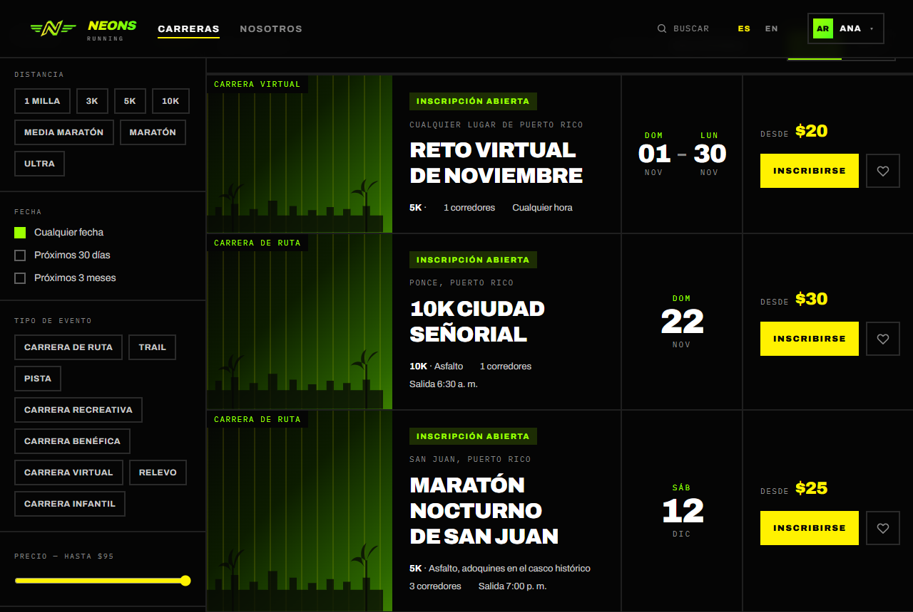

1. Escribe en el buscador un nombre, una ciudad o un organizador y pulsa
   **Buscar**.
2. Abre **Filtros** para acotar:
   - **Distancia**: 1 milla, 3K, 5K, 10K, Media maratón, Maratón, Ultra.
   - **Fecha**: Cualquier fecha, Próximos 30 días, Próximos 3 meses.
   - **Tipo de evento**: Carrera de ruta, Trail, Pista, Carrera recreativa,
     Carrera benéfica, Carrera virtual, Relevo, Carrera infantil.
   - **Dificultad**: Fácil, Moderada, Difícil.
   - **Estado de la inscripción**: Abierta ahora, Abre pronto, Casi llena.
   - **Precio — hasta** un monto máximo.
3. Elige el orden en **Ordenar**: Recomendadas, Más próximas, Más populares,
   Distancia o Precio.
4. Cambia entre **Lista** y **Mapa** para ver las carreras en el mapa de Puerto
   Rico.
5. Pulsa **Limpiar** para quitar todos los filtros.

Las carreras marcadas **Cualquier lugar** son virtuales: las corres donde
quieras y envías tu tiempo como evidencia (ver
[2.7](#27-enviar-tu-resultado)).

> **🛠 Nota técnica:** la búsqueda y los filtros los resuelve la función SQL
> `search_events()` a través de `/api/events`, paginada. El estado de la
> inscripción se calcula en `lib/events/availability.ts`: **Casi llena** a
> partir del 90 % del cupo, contando solo inscripciones pagadas.

## 2.2 Ver el detalle de una carrera

**Dónde:** pulsa cualquier tarjeta de carrera.

La página reúne todo lo que necesitas antes de inscribirte:

- **La carrera de un vistazo**: distancia, hora de salida, terreno, cierre de
  inscripción y cupos disponibles.
- Pestañas **Resumen**, **Detalles**, **Ruta**, **Programa** y
  **Organizador**: descripción, qué incluye, categorías, edad mínima, tiempo
  límite, estaciones de hidratación, mapa de ruta, estacionamiento e
  indicaciones.
- La **capacidad** (qué tan llena está) y los **Corredores inscritos**.
- Botones para compartir la carrera.

El botón principal cambia según el estado:

| Lo que ves | Qué significa |
| --- | --- |
| **Inscribirme ahora** | La inscripción está abierta. |
| **Inscripciones abren el …** / **abren pronto** | Todavía no se puede inscribir nadie. |
| **Inscripciones cerradas** | Pasó la fecha de cierre. |
| **Agotado** | No quedan cupos en ninguna categoría, o el organizador marcó la carrera como agotada. |

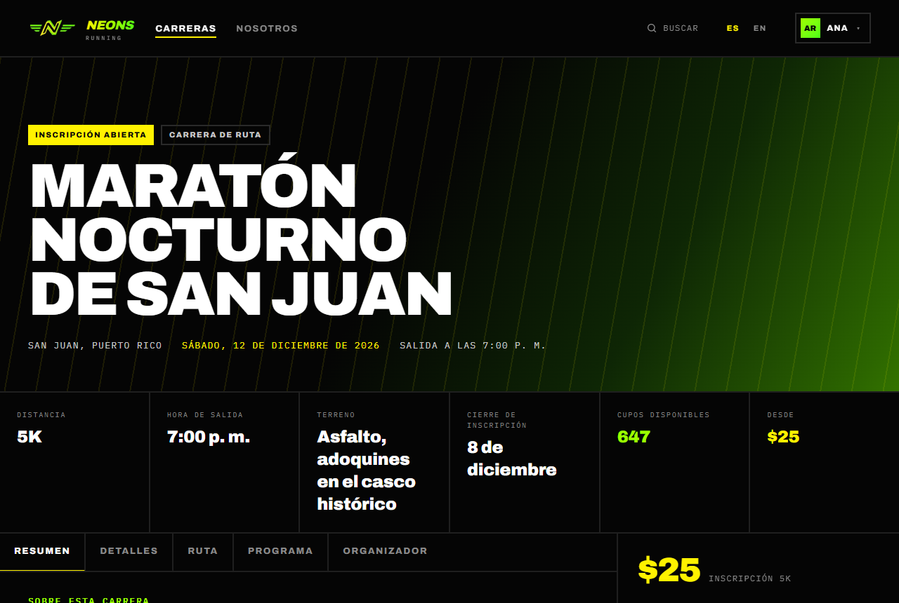

El precio, el botón **Inscribirme ahora**, **Guardar carrera** y los botones para compartir están en la columna derecha.

## 2.3 Guardar carreras

**Para qué sirve:** tener a mano las carreras que te interesan.

1. Inicia sesión.
2. Pulsa el **corazón** en la tarjeta de la carrera, o **Guardar carrera** en
   su página. Verás el aviso *"… se añadió a tus carreras guardadas"*.
3. Encuentra tus carreras en **Mi perfil** → **Carreras guardadas**.
4. Para quitar una, vuelve a pulsar el corazón.

> **🛠 Nota técnica:** se guarda en `saved_events` (`setEventSavedAction`,
> `lib/events/saved.ts`). Solo se pueden guardar eventos publicados, y si un
> evento se borra, sus guardados se borran con él (cascade).

## 2.4 Inscribirse en una carrera

**Para qué sirve:** reservar tu cupo y pagar. Al terminar recibes tu **número
de dorsal** y un recibo por correo.

**Requisitos:** tener la sesión iniciada y que la inscripción esté abierta. Si
pulsas **Inscribirme ahora** sin sesión, la aplicación te pide iniciar sesión y
luego te regresa a la inscripción.

La inscripción tiene **5 pasos**. Puedes volver atrás con **Atrás** sin perder
lo que escribiste.

### Paso 1 · Carrera

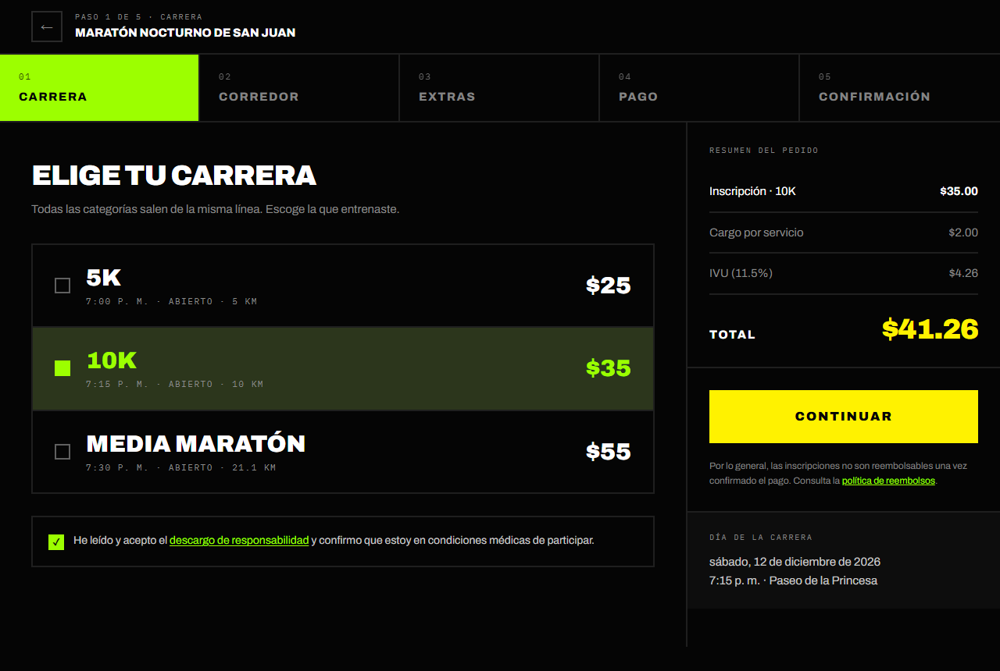

1. Elige la **categoría** (distancia) que vas a correr. Cada una muestra su
   hora de salida, corral y kilómetros. Las agotadas no se pueden elegir.
2. Marca **He leído y acepto el descargo de responsabilidad…**. Es obligatorio.
3. Pulsa **Continuar**.

### Paso 2 · Corredor

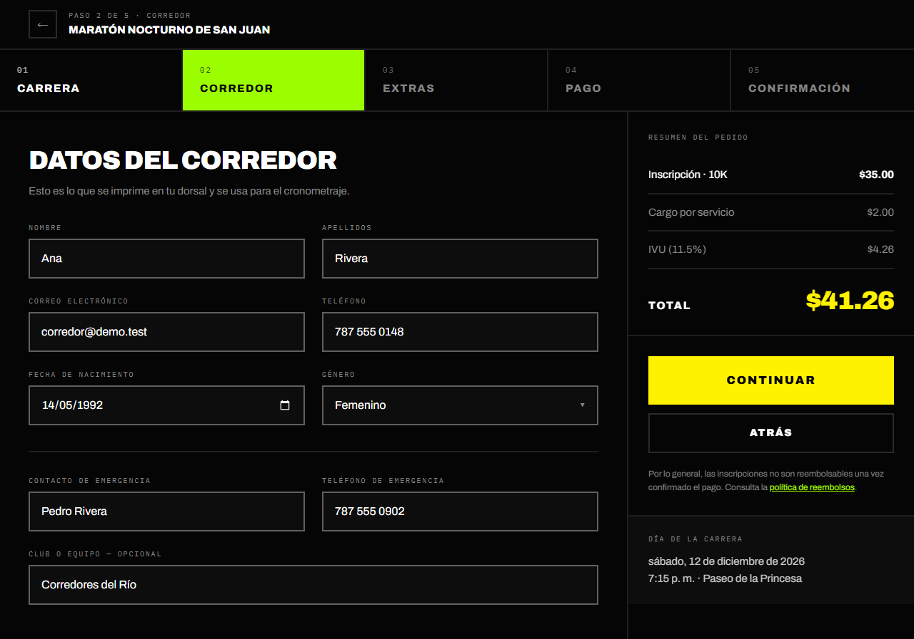

Estos datos se imprimen en tu dorsal y se usan para el cronometraje. Vienen
llenos con lo que tengas en tu perfil (ver [2.9](#29-ajustes-de-la-cuenta)).

| Campo | Obligatorio | Nota |
| --- | --- | --- |
| Nombre y Apellidos | Sí | Como aparecen en tu identificación |
| Correo electrónico | Sí | Ahí llegan el dorsal y el recibo |
| Teléfono | Sí | Al menos 7 dígitos, p. ej. 787 555 0123 |
| Fecha de nacimiento | Sí | Define tu grupo de edad |
| Género | Sí | Incluye "Prefiero no decirlo" |
| Contacto y teléfono de emergencia | Sí | Para el personal médico |
| Club o equipo | No | |

Pulsa **Continuar**. Si falta algo, el campo se marca en rojo.

### Paso 3 · Extras

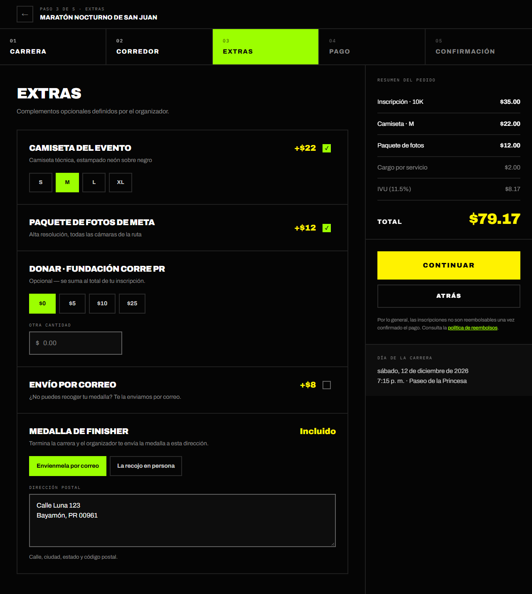

Solo aparecen los extras que ofrece el organizador de esa carrera:

- **Camiseta del evento**: márcala y elige la talla (XS a XXL).
- **Paquete de fotos de meta**.
- **Donar**: elige una cantidad ($5, $10, $25) u **Otra cantidad**, hasta
  $1,000.
- **Envío por correo**: recibe el paquete de la carrera en tu casa, con un
  cargo de envío. En carreras que incluyen las medallas en el envío, el paquete
  y la medalla viajan juntos, en un solo envío, **cuando termines**. Si no lo
  eliges, recoges ambos en persona.

Si eliges el envío, escribe la **Dirección postal** (calle, ciudad, estado y
código postal). Si guardaste una en Ajustes, ya aparece escrita.

Al pulsar **Continuar** se **reserva tu cupo por 30 minutos** mientras pagas.

### Paso 4 · Pago

El **Resumen del pedido** aparece a la derecha en todos los pasos y se actualiza con cada elección. La captura del pago está en [2.5](#25-pagar-con-ath-móvil).

1. Revisa el **Resumen del pedido**:

   | Línea | Detalle |
   | --- | --- |
   | Inscripción · categoría | Precio de la categoría |
   | Camiseta, fotos, envío y manejo | Si los elegiste |
   | Cargo por servicio | $2.00 |
   | IVU (11.5 %) | Solo si la carrera lo cobra; sobre todo excepto la donación |
   | Donación | Sin IVU |
   | **Total** | Lo que pagas |

2. Elige el **Método de pago**:
   - **Tarjeta**: crédito o débito, Apple Pay o Google Pay. Confirmación
     inmediata. Los datos de tu tarjeta van directo a Stripe; NEONS RUNNING
     nunca los ve ni los guarda.
   - **ATH Móvil**: solo si el organizador lo tiene activo. La verificación es
     manual (ver [2.5](#25-pagar-con-ath-móvil)).
3. Con tarjeta, escribe los datos y pulsa **Completar inscripción**.

> Por lo general, las inscripciones **no son reembolsables** una vez
> confirmado el pago. Consulta la política de reembolsos enlazada en este paso.

### Paso 5 · Confirmación

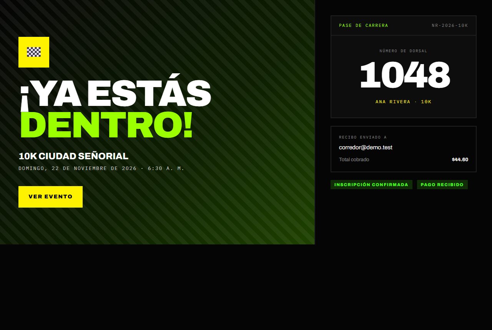

Verás **¡Ya estás dentro!** con tu **Pase de carrera**: número de dorsal,
nombre, categoría, total cobrado y el correo al que enviamos el recibo. Si
vuelves a abrir la inscripción de esa carrera, verás esta misma pantalla.

### Problemas frecuentes al inscribirse

| Mensaje | Qué hacer |
| --- | --- |
| *Ya estás inscrito en esta carrera.* | Tu inscripción ya existe; búscala en tu perfil. |
| *Esa categoría se acaba de agotar.* | Vuelve al paso 1 y elige otra distancia. |
| *Tu edad el día de la carrera está fuera de los límites…* | La carrera tiene un límite de edad mínima o máxima. |
| *La inscripción para esta carrera está cerrada.* | Pasó la fecha de cierre. |
| *El organizador cambió los extras de esta carrera.* | Vuelve al paso 3 y revisa lo que elegiste. |
| *Tu pago aún se está procesando…* | Vuelve a la página en un rato; se confirma al acreditarse. |
| *Tu espacio estuvo reservado 2 horas sin pago…* | Espera 15 minutos y vuelve a intentarlo. |
| *Demasiados intentos de pago en la última hora.* | Espera un poco antes de reintentar. |

**¿Cancelar una inscripción?** El corredor no puede cancelarla por su cuenta.
Escribe al equipo desde **Contacto** o al organizador de la carrera.

> **🛠 Nota técnica:** al salir del paso 3, `startRegistrationPaymentAction`
> (`lib/events/registrations.ts`) llama a `register_for_event()`, que dentro de
> una transacción comprueba cupo, edad, fechas y extras, crea la inscripción
> como **pendiente**, calcula el monto (el servidor recalcula el total; no
> confía en el navegador) y abre un PaymentIntent de Stripe.
> `completeRegistrationPaymentAction` confirma el cobro y asigna el dorsal. El
> webhook `/api/stripe/webhook` y `reconcilePendingPayment` (al volver a abrir
> la página) cubren los pagos que el navegador no llegó a confirmar. Las cifras
> de `lib/events/pricing.ts` deben coincidir con `register_for_event()`
> (hoy en `20261202120000_optional_sales_tax.sql`), que cobra el IVU solo
> cuando el evento tiene `charges_sales_tax`. Las carreras de demostración
> (`event.bookable = false`) recorren el flujo sin cobrar ni guardar nada.

## 2.5 Pagar con ATH Móvil

**Para qué sirve:** pagar desde la app de ATH Móvil en lugar de con tarjeta.

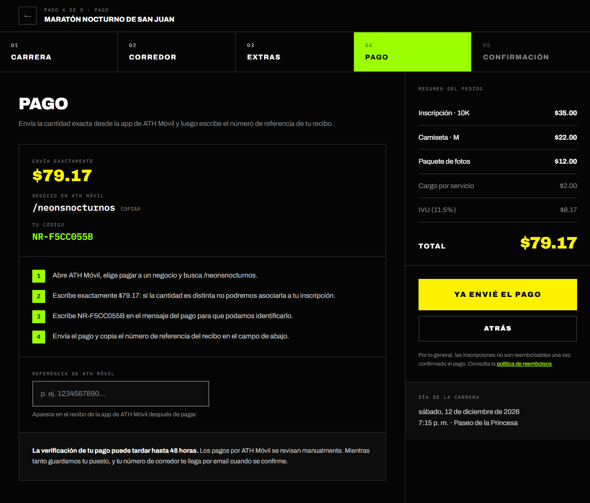

> En esta captura solo aparece ATH Móvil. Cuando el pago con tarjeta está disponible, primero verás el selector **Método de pago** con **Tarjeta** y **ATH Móvil**.

1. En el paso 4, elige **ATH Móvil**.
2. Abre la app de ATH Móvil y escanea el **código QR** o paga a un negocio
   buscando el nombre indicado (**Negocio en ATH Móvil**). Puedes pulsar
   **Copiar** para copiar el nombre.
3. Envía **exactamente** la cantidad indicada. Si la cantidad es distinta, no
   podremos asociar el pago a tu inscripción.
4. Escribe **Tu código** (aparece en pantalla) en el mensaje del pago.
5. Copia el **número de referencia** del recibo de ATH Móvil en el campo
   **Referencia de ATH Móvil**.
6. Pulsa **Ya Envié el Pago**.

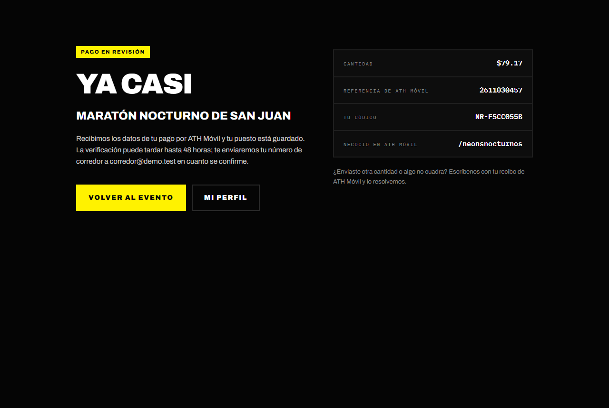

Verás **Ya casi** y **Pago en revisión**. Tu cupo queda guardado mientras el
organizador o el equipo verifica el pago, lo que puede tardar **hasta 48
horas**. Cuando se confirme, te llegará el número de dorsal por correo.

**Si no se confirma**, recibes el correo *"Tu pago por ATH Móvil para … no se
confirmó"* y, al volver a la inscripción, verás un aviso para pagar de nuevo.
Si se te cobró, escríbenos con tu recibo.

> **🛠 Nota técnica:** `submitAthMovilPaymentAction` guarda la referencia y
> notifica al organizador (correo *Pago por ATH Móvil por revisar*). Lo aprueba
> el organizador del evento desde su página o un administrador desde
> `/admin/payments` (`reviewAthMovilPaymentAction`). Una referencia no se
> puede reutilizar en otra inscripción, y hay un tope de referencias rechazadas
> por inscripción. El plazo está en `REVIEW_HOURS` (`lib/ath-movil/config.ts`).

## 2.6 Tu perfil

**Dónde:** **Mi perfil** en el menú de tu cuenta (`/runners/me`).

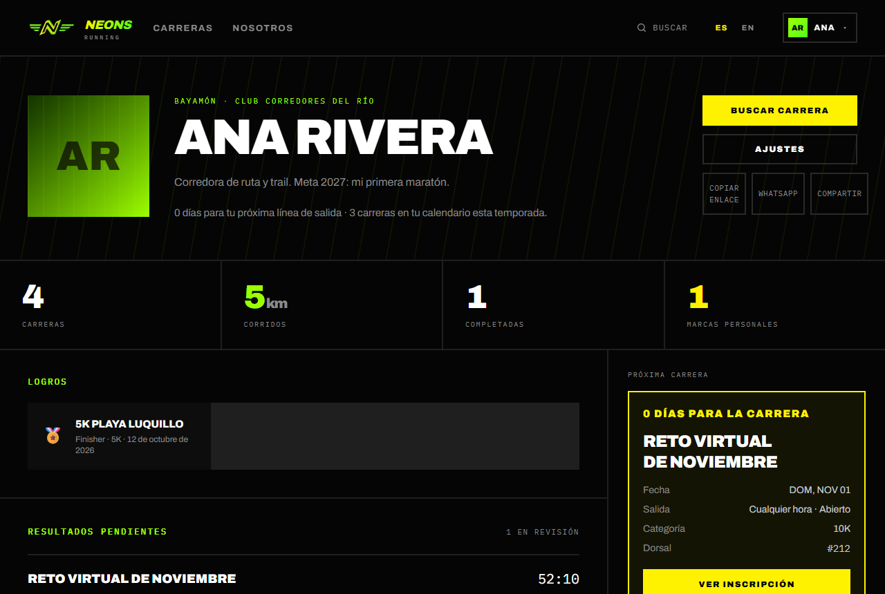

Tu perfil es tu página principal. Lo que ves tú y lo que ven los demás:

| Sección | Qué muestra | ¿La ven otros? |
| --- | --- | --- |
| Encabezado | Foto, nombre, ciudad, club y días para tu próxima carrera | Sí (sin la cuenta regresiva) |
| **Estadísticas de carrera** | Carreras, corridas, completadas, marcas personales | Sí |
| **Logros** | Medallas de tus resultados aceptados | Sí |
| **Resultados pendientes** | Resultados que enviaste y aún no se revisan | Solo tú |
| **Correo** | Kits y medallas que van por correo | Solo tú |
| **Historial de carreras** | Tus resultados oficiales | Sí |
| **Próximas** | Tus inscripciones, con categoría, corral y dorsal | Solo tú |
| **Carreras guardadas** y **Recomendadas para ti** | Tus favoritas y sugerencias | Solo tú |

Una inscripción con el pago por ATH Móvil en revisión aparece como
**Pendiente**. Desde **Próxima carrera** puedes abrir **Ver inscripción** (tu
pase con el dorsal) o **Ver evento**.

En el **Historial de carreras**, cada resultado muestra el tiempo oficial y el
ritmo. **MP** marca una marca personal, y *Evidencia verificada por el
organizador* indica que el organizador lo confirmó: aceptó tu captura o
registró tu llegada por ti.

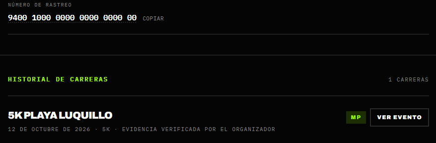

### Cambiar tu foto de perfil

1. En tu perfil, pulsa **Añadir foto** (o **Cambiar foto**).
2. Elige una imagen JPG, PNG, WebP o HEIC de menos de 40 MB.
3. Se sube y se guarda sola. Para quitarla, pulsa **Quitar foto**; tu perfil
   volverá a mostrar tus iniciales.

> **🛠 Nota técnica:** `/runners/me` se resuelve contra la sesión
> (`SELF_ID` en `lib/auth/routes.ts`); los perfiles públicos son
> `/runners/<id>`. Las secciones privadas solo se consultan cuando
> `isSelf` es verdadero. La foto se convierte a WebP en el navegador antes de
> subirla (`components/profile/profile-photo.tsx`).

## 2.7 Enviar tu resultado

**Para qué sirve:** que tu tiempo quede oficial y tu medalla
aparezca en tu perfil. Funciona en las carreras que **aceptan evidencia de
llegada**, sobre todo las virtuales.

**Requisitos:** inscripción confirmada (pagada), y que ya sea el día de la
carrera o después.

**Dónde:** en la página de la carrera, el recuadro **Tu resultado**.

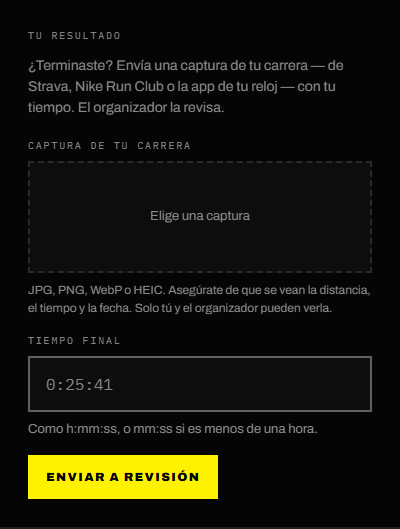

1. Pulsa **Elige una captura** y sube una imagen de tu carrera (de Strava, Nike
   Run Club o la app de tu reloj). Deben verse la **distancia**, el **tiempo**
   y la **fecha**.
2. Escribe tu **Tiempo final** como `h:mm:ss`, o `mm:ss` si es menos de una
   hora (por ejemplo `0:25:41`). Si el teclado del teléfono no tiene `:`,
   escribe solo los números: `2541` es 25:41 y `12541` es 1:25:41. También
   valen `.` o espacios como separadores, y las décimas (`25:41.3`) se
   redondean hacia arriba al segundo siguiente.
3. Pulsa **Enviar a revisión**.

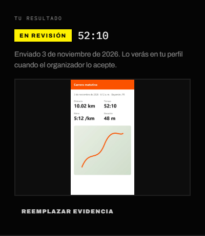

Mientras está en revisión puedes pulsar **Reemplazar evidencia** para subir otra captura. El organizador lo revisa y te avisa por correo. Puedes seguir el estado en
**Mi perfil** → **Resultados pendientes**:

| Estado | Qué significa | Qué hacer |
| --- | --- | --- |
| **En revisión** | El organizador aún no lo revisa. | Esperar. |
| **Aceptado** | Tu resultado y tu medalla ya están en tu perfil. | — |
| **Devuelto** | El organizador no pudo verificarlo; verás su nota. | Pulsa **Enviar de nuevo** con una captura más clara. |
| **Descalificado** | El organizador lo descalificó y explicó el motivo. | Contáctanos si crees que es un error. |

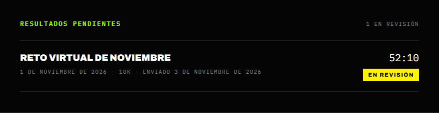

Si no logras enviar la captura, pídele al organizador que **marque tu
llegada**: escribe tu tiempo por ti y el resultado queda aceptado al momento,
con la medalla, sin captura. Recibes el mismo correo de resultado oficial.

La captura **solo la ven tú y el organizador**. Los resultados oficiales de
cada carrera son públicos en `/events/<carrera>/results`.

> **🛠 Nota técnica:** la captura se convierte a WebP y se sube desde el
> navegador al bucket privado `race-evidence`; el servidor solo recibe la ruta
> (`submitRaceResultAction`, `lib/results/actions.ts`). La opción del evento es
> `events.accepts_results`.

## 2.8 Kit y medalla por correo

**Para qué sirve:** seguir tu envío, con un solo número de rastreo para el
paquete y la medalla, y cambiar cómo quieres recibir la medalla.

**Dónde:** **Mi perfil** → sección **Correo**. Solo aparece si tienes algo por
correo o por recoger.

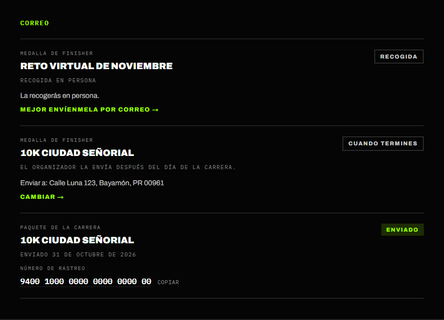

| Estado | Qué significa |
| --- | --- |
| **En preparación** | El organizador aún no envía el paquete. |
| **Cuando termines** | El envío sale cuando el organizador acepte tu llegada o después del día de la carrera. Si tu paquete ya salió, la medalla lo sigue. |
| **Enviado** | Ya va en camino; verás el **Número de rastreo** si el organizador lo añadió (pulsa **Copiar**). |
| **Recogida** | Elegiste recoger la medalla en persona (debajo dice *Recogida en persona*) o ya la recogiste (debajo dice *Recogida el* y la fecha). |

**Cambiar cómo recibes la medalla:** pulsa **Cambiar** (o **Mejor envíenmela
por correo**), elige **Envíenmela por correo** o **La recojo en persona**,
escribe la dirección si hace falta y guarda. Puedes cambiarlo hasta que la
medalla se envíe o la recojas. El correo es parte del extra pagado **Envío por
correo**: sin él no puedes pasar a recibirla por correo.

Cuando el organizador marca tu envío, recibes un correo con el número de
rastreo.

## 2.9 Ajustes de la cuenta

**Dónde:** menú de tu cuenta → **Ajustes** (`/runners/me/settings`).

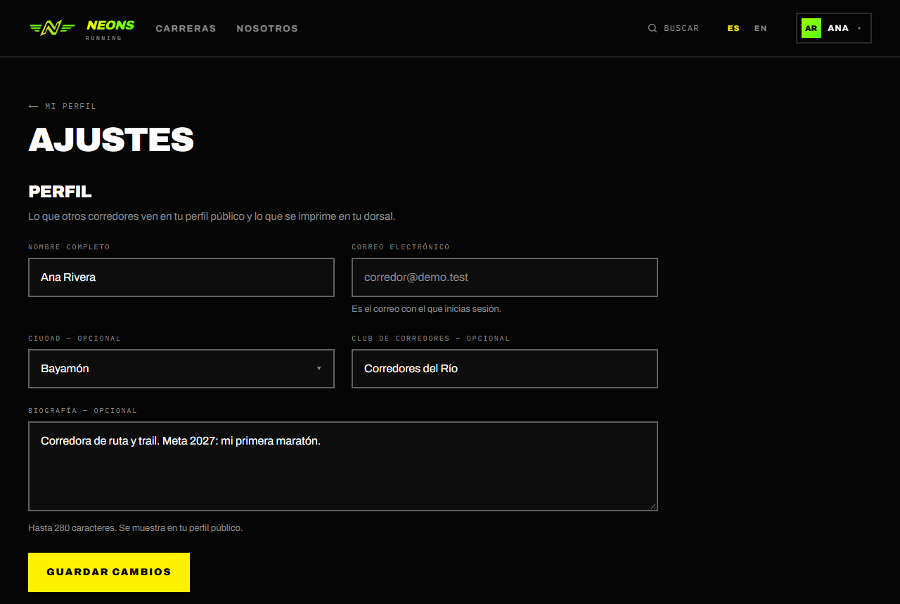

| Sección | Qué puedes hacer |
| --- | --- |
| **Perfil** | Cambiar nombre, ciudad, club y biografía. Se ve también el correo con el que inicias sesión. |
| **Datos para carreras** | Fecha de nacimiento, género, teléfono, talla de camiseta y contacto de emergencia. **Privado**: solo lo ven tú y los organizadores de tus carreras; el equipo de NEONS RUNNING también puede ver tu teléfono y tu contacto de emergencia. Llena la inscripción automáticamente. |
| **Dirección postal** | Dónde enviamos tu kit o medalla. **Privada**. Llena el paso de extras automáticamente. |
| **Notificaciones** | Activar o desactivar los correos de **Recordatorios de carrera**, **Resultados publicados** y **Actualizaciones del evento**. |
| **Tipo de cuenta** | Ver tu rol y [pedir acceso de organizador](#210-pedir-acceso-de-organizador). |
| **Privacidad** | **Perfil público**: si está activo, otros corredores pueden ver tu perfil e historial. Los resultados oficiales son públicos de todos modos. **Exportar mis datos**: descarga un archivo con tu perfil, datos privados, inscripciones, pagos, resultados y guardados. |
| **Zona de peligro** | **Borrar cuenta**: ver abajo. |

Cada sección tiene su propio botón **Guardar cambios**. Los interruptores de **Notificaciones** y la casilla **Perfil público** se guardan al cambiarlos.

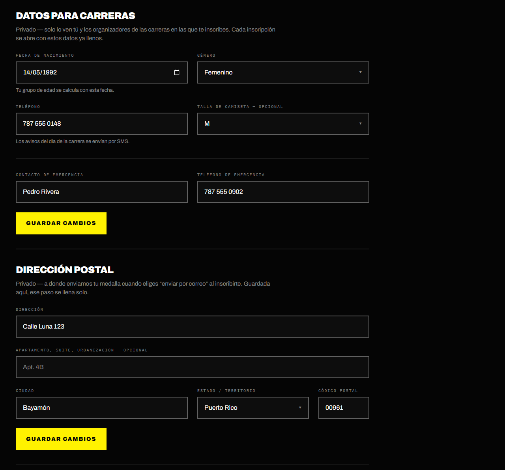

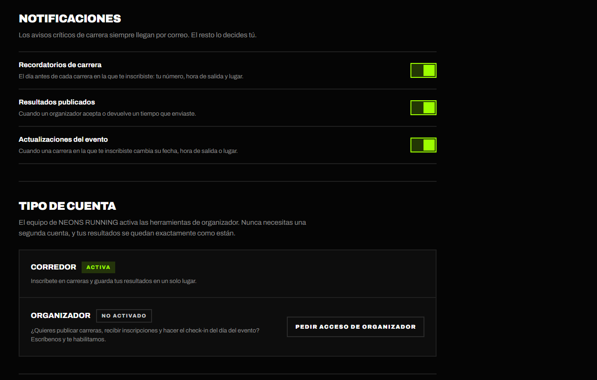

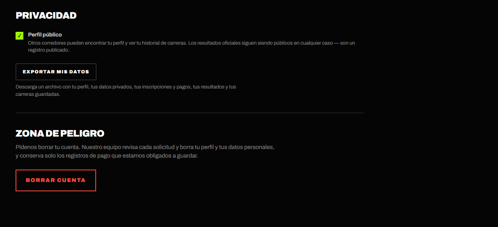

### Borrar tu cuenta

1. En **Zona de peligro**, pulsa **Borrar cuenta** y luego **Solicitar borrado**.
2. El equipo revisa cada solicitud y borra tu perfil y tus datos personales.
   Solo conserva los registros de pago que la ley obliga a guardar. Te
   escribiremos cuando esté listo.
3. Mientras tanto puedes retirar la solicitud con **Retirar solicitud**.

Borrar la cuenta **no reembolsa** tus inscripciones próximas. Si quieres un
reembolso, escríbenos antes.

> **🛠 Nota técnica:** los datos privados están en `profile_private`, separados
> de `profiles` (público según `is_public`, que por defecto es `true`). La
> exportación es un JSON generado por `exportMyDataAction`
> (`lib/profile/actions.ts`), con límite de frecuencia. El borrado no es
> automático: crea una fila en `account_deletion_requests` y envía al equipo el
> correo *Solicitud de borrado de cuenta*.

## 2.10 Pedir acceso de organizador

**Para qué sirve:** publicar tus propias carreras, recibir inscripciones y hacer
el check-in el día del evento.

1. Ve a **Ajustes** → **Tipo de cuenta**.
2. Pulsa **Pedir acceso de organizador**. Se abre el formulario de **Contacto**.
3. Cuéntale al equipo qué carreras organizas y envía el mensaje.
4. Cuando el equipo active tu cuenta, verás **Panel de organizador** en tu menú.
   Es la misma cuenta: tus inscripciones y resultados no cambian.

> **🛠 Nota técnica:** para activar a un organizador, el equipo cambia
> `profiles.account_type` a `'organizer'` directamente en la base de datos. Los
> usuarios no pueden cambiar esa columna.

## 2.11 Funciones en desarrollo

Estas partes se ven en la aplicación pero **todavía no funcionan del todo**:

- **Seguir a otros corredores**: el botón **Seguir** cambia en pantalla, pero
  no se guarda.
- **Centro de notificaciones** (`/notifications`): por ahora siempre está
  vacío. Los avisos llegan **por correo**.

> **🛠 Nota técnica:** `FollowButton` solo usa estado local, y
> `/notifications` recibe una lista vacía (no hay tabla de notificaciones). El
> texto vacío del centro de notificaciones dice que los recordatorios llegan
> "tres días antes", pero el correo real se envía **el día antes**: conviene
> corregir ese texto en `dictionaries/*.json` (`notifications.emptyBody`).

## Correos que recibe el corredor

| Correo (asunto) | Cuándo llega | ¿Se puede desactivar? |
| --- | --- | --- |
| **¡Estás inscrito! …** | Al confirmarse el pago, con tu dorsal | No |
| **Mañana: …** | El día antes de la carrera: dorsal, hora de salida y lugar | Sí — Recordatorios de carrera |
| **Actualización: … cambió** | El organizador cambió la fecha, la hora o el lugar | Sí — Actualizaciones del evento |
| **… fue cancelado** / **… fue retirado** / **… volvió** | Cambios de estado del evento | No |
| **Tu pago por ATH Móvil para … no se confirmó** | Un pago por ATH Móvil fue rechazado | No |
| **Tu pago para … está en revisión de nuevo** | El organizador devolvió tu inscripción a pendiente | No |
| **Tu inscripción en … fue cancelada** | El organizador quitó tu inscripción | No |
| **Te reembolsamos tu pago para …** | La app cobró la tarjeta pero no pudo confirmar la inscripción (por ejemplo, la carrera se llenó mientras pagabas) y devolvió el pago completo automáticamente | No |
| **Tu resultado de … es oficial** / **necesita revisión** / **fue descalificado** | El organizador revisó tu resultado o registró tu llegada | Sí — Resultados publicados |
| **Tu envío de … va en camino** | El organizador marcó tu envío | No |

Cada correo opcional trae al pie el enlace **Elige qué correos recibes**, que
abre las preferencias en Ajustes (ver
[Correos y notificaciones](06-correos.md#65-elegir-qué-correos-recibir)).

> **🛠 Nota técnica:** los correos se envían con Brevo a través de una cola
> (`lib/email/outbox.ts`) que procesa `/api/cron/email-outbox` cada 10
> minutos. Los recordatorios los genera `/api/cron/race-reminders`, que corre
> cada hora (pg_cron, migración `20261125120000_schedule_cron_routes.sql`) y
> nunca avisa dos veces a la misma persona. Las plantillas están en
> `lib/email/`; la baja de un correo la procesa `/api/email/unsubscribe`.

---

[← Primeros pasos](01-primeros-pasos.md) · [Índice](README.md) · [Guía del organizador →](03-organizador.md)
