# 3. Guía del organizador

[← Volver al índice](README.md)

Un **organizador** es un corredor al que el equipo de NEONS RUNNING le activó
las herramientas para publicar y gestionar eventos. Es la misma cuenta: el
organizador puede seguir inscribiéndose en carreras como cualquier corredor
(ver la [guía del corredor](02-corredor.md)).

**¿Cómo se obtiene?** Desde **Ajustes** → **Tipo de cuenta** → **Pedir acceso
de organizador**, que abre el formulario de contacto. Cuando el equipo lo
activa, aparece **Panel de organizador** en el menú de la cuenta (ver
[2.10](02-corredor.md#210-pedir-acceso-de-organizador)). Si una cuenta sin el
rol abre una página de organizador, ve el aviso *"Esta sección es para
organizadores"* con un botón para contactar al equipo.

## Resumen: qué puede hacer un organizador

| Tarea | Dónde |
| --- | --- |
| [Ver el panel y las métricas](#31-panel-de-organizador) | **Panel de organizador** (`/organizer`) |
| [Crear y publicar un evento](#32-crear-y-publicar-un-evento) | **Crear evento** (`/publish`) |
| [Editar o eliminar un evento](#33-editar-o-eliminar-un-evento) | **Mis eventos** → **Editar** / **Eliminar** |
| [Confirmar pagos de ATH Móvil](#34-confirmar-pagos-de-ath-móvil) | Página del evento → **Pagos pendientes** |
| [Gestionar las inscripciones](#35-gestionar-las-inscripciones) | Página del evento → **Inscripciones** |
| [Enviar kits y medallas](#36-enviar-kits-y-medallas) | Página del evento → **Inscripciones** |
| [Hacer el check-in el día de la carrera](#37-check-in-el-día-de-la-carrera) | **Registro del día de la carrera** |
| [Revisar resultados](#38-revisar-resultados) | Página del evento → **Resultados por revisar** |

> **Dónde se gestiona cada evento:** todo lo de un evento concreto (pagos,
> inscripciones, envíos, resultados) está **en la propia página del evento**.
> Cuando la abre su organizador, encima de la información pública aparecen
> secciones que solo ve él (y los administradores).

> **🛠 Nota técnica:** las páginas de organizador comprueban el rol con
> `requireOrganizer()` (`lib/auth/session.ts`). En la base de datos, todo
> evento se escribe a través de `save_event()` y `delete_event()` (funciones
> `security definer`); los organizadores no tienen permisos directos sobre las
> tablas `events` ni `event_categories` (migración
> `20261115120000_event_writes_through_functions.sql`). Las secciones privadas
> de la página del evento se muestran cuando `canManage` es verdadero: el
> usuario es el organizador del evento o un administrador
> (`app/[lang]/(site)/events/[slug]/page.tsx`).

---

## 3.1 Panel de organizador

**Dónde:** menú de la cuenta → **Panel de organizador** (`/organizer`).

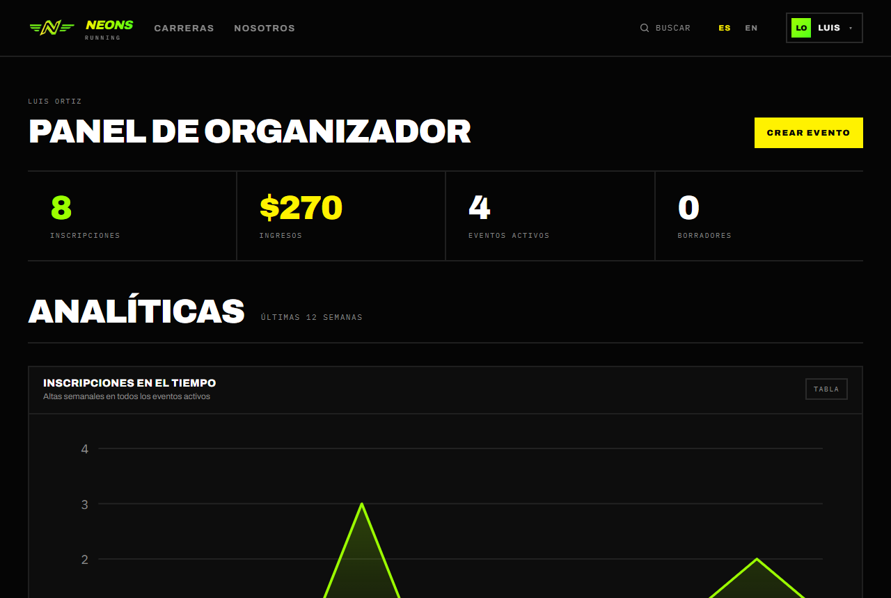

Arriba están las cifras de todos tus eventos:

| Cifra | Qué cuenta |
| --- | --- |
| **Inscripciones** | Inscripciones pagadas |
| **Ingresos** | Lo cobrado por esas inscripciones |
| **Eventos activos** | Eventos publicados que aún no han pasado |
| **Borradores** | Eventos guardados sin publicar |

**Analíticas** muestra las últimas 12 semanas: inscripciones en el tiempo,
ingresos y demografía de los corredores. Cada gráfica tiene un botón
**Tabla** para ver los datos como tabla.

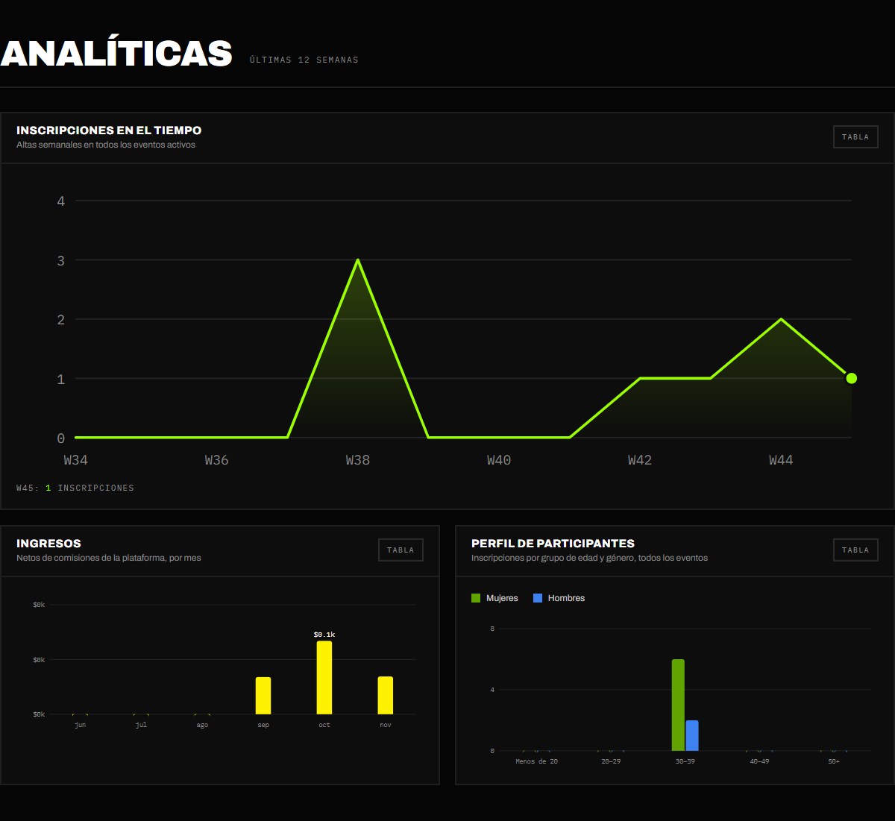

**Mis eventos** lista cada evento con su estado (**En vivo**, **Borrador**,
**Finalizado**, **Retirado**), cuántos corredores tiene frente al cupo y sus
ingresos. Cada tarjeta tiene:

- **Editar**: abre el asistente con los datos del evento.
- **Ver evento**: abre la página pública, donde también lo gestionas.
- **Inscripciones (n)**: si el evento tiene inscritos, va directo a su lista
  de inscripciones.
- **Eliminar**: aparece en su lugar cuando el evento no tiene inscripciones
  pagadas ni pagos de ATH Móvil pendientes.

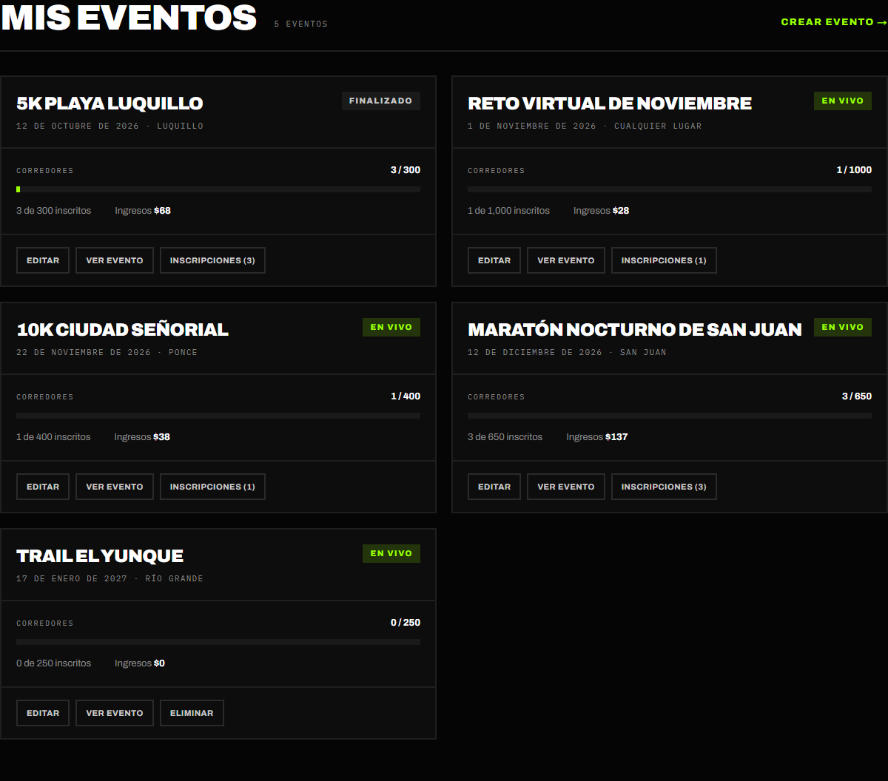

Si NEONS RUNNING retiró uno de tus eventos, la tarjeta lo indica: ya no
aparece en el listado, no se puede editar y te enviamos el motivo por correo.

## 3.2 Crear y publicar un evento

**Dónde:** **Crear evento** en el panel (`/publish`).

El asistente tiene **10 pasos**. La columna izquierda muestra en qué paso
estás; avanza con **Continuar** y regresa con **Atrás**. Puedes **Guardar
borrador** en cualquier momento: un borrador solo lo ves tú.

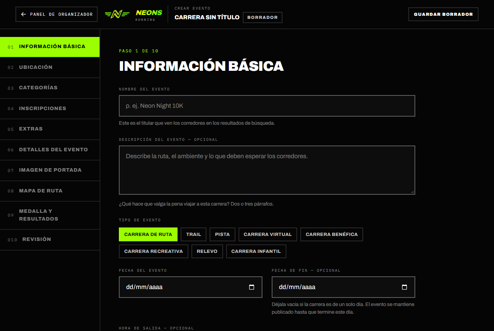

### Paso 1 · Información básica

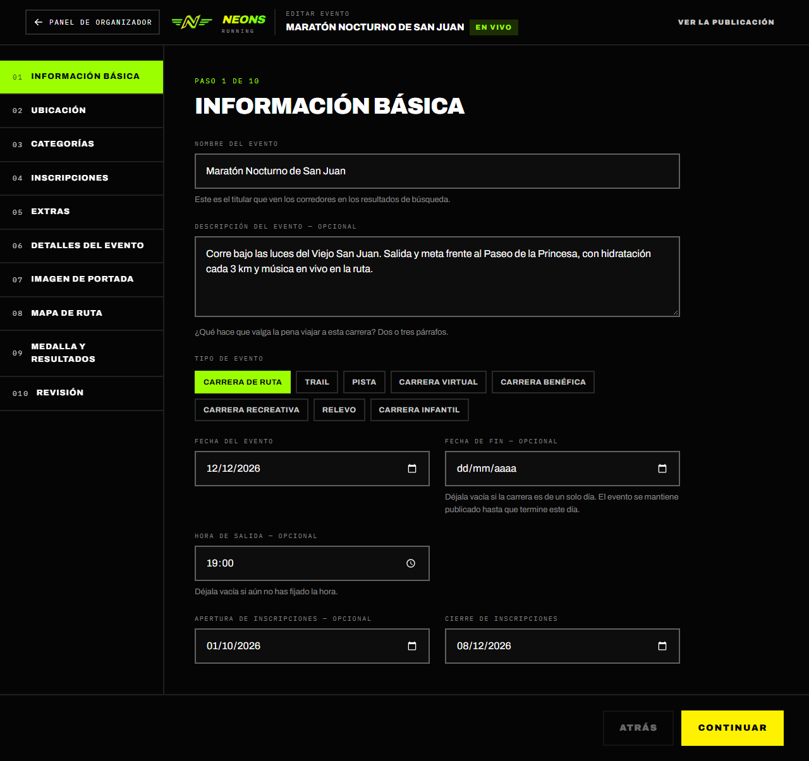

| Campo | Obligatorio | Nota |
| --- | --- | --- |
| Nombre del evento | Sí | Entre 3 y 120 caracteres. Es el titular en los resultados de búsqueda. |
| Descripción | No | Hasta 4,000 caracteres. |
| Tipo de evento | Sí | Ruta, Trail, Pista, Virtual, Benéfica, Recreativa, Relevo o Infantil. |
| Fecha del evento | Sí | No puede estar en el pasado, a menos que marques el evento como **Agotado**. |
| Fecha de fin | No | Solo para eventos de varios días. El evento sigue publicado hasta ese día. |
| Hora de salida | No | Déjala vacía si aún no está fijada (o si se puede salir a cualquier hora en un evento de varios días). |
| Apertura de inscripciones | No | Antes de esa fecha la carrera se ve como **Abre pronto**. |
| Cierre de inscripciones | Sí | A más tardar el último día de la carrera, y de hoy en adelante (salvo en un evento **Agotado**). |
| Agotado | No | Cierra las inscripciones y muestra el evento como **Agotado**, sin importar cuántos cupos queden. |

**Publicar una carrera que ya celebraste.** Marca **Agotado** y podrás usar
fechas pasadas. El evento se queda en la lista de carreras, después de todas
las próximas, y aparece en la portada mientras haya menos de cinco carreras
próximas. No acepta inscripciones y no muestra un conteo de corredores. Si
quitas la marca a una carrera que ya pasó, sale de la lista; su página sigue
disponible por su enlace.

Puedes marcar **Agotado** en cualquier momento desde **Editar**. Quien ya
estaba pagando puede terminar su pago; solo se rechazan las inscripciones
nuevas. Al quitar la marca, la inscripción vuelve a su estado normal.

### Paso 2 · Ubicación

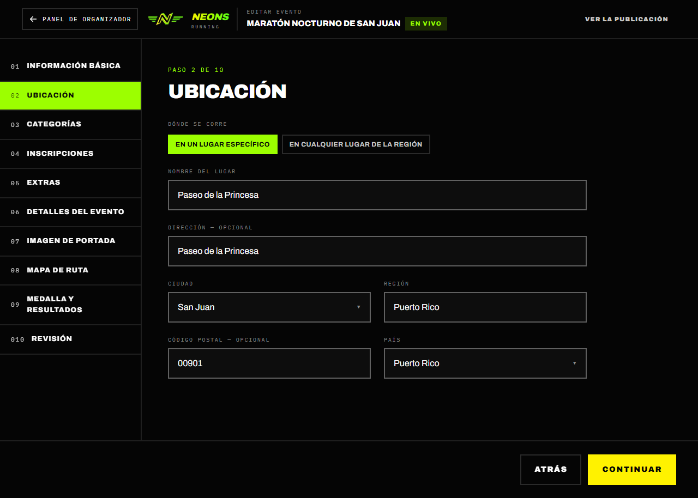

Elige **Dónde se corre**:

- **En un lugar específico**: nombre del lugar, dirección (opcional), ciudad
  (uno de los 78 municipios), región, código postal (opcional) y país.
- **En cualquier lugar de la región**: para carreras virtuales. No hay lugar
  ni ciudad, y el evento no tiene check-in presencial.

### Paso 3 · Categorías

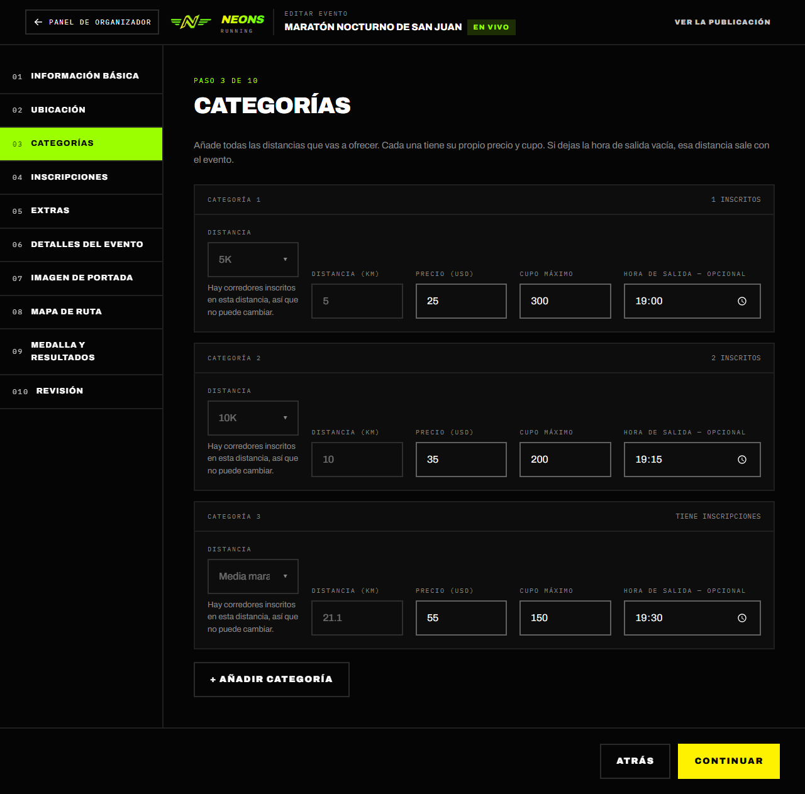

Cada categoría es una distancia con su **precio**, su **cupo máximo** y una
**hora de salida** opcional (si la dejas vacía, sale con el evento).

- Pulsa **+ Añadir categoría** para añadir otra. Puedes tener **hasta 7** y
  cada distancia solo una vez.
- El precio va de $0 a $1,000.
- Cuando una categoría ya tiene corredores inscritos, verás *"N inscritos"*:
  su **distancia** ya no se puede cambiar, no puedes quitarla y su cupo no
  puede bajar de los inscritos.

### Paso 4 · Inscripciones

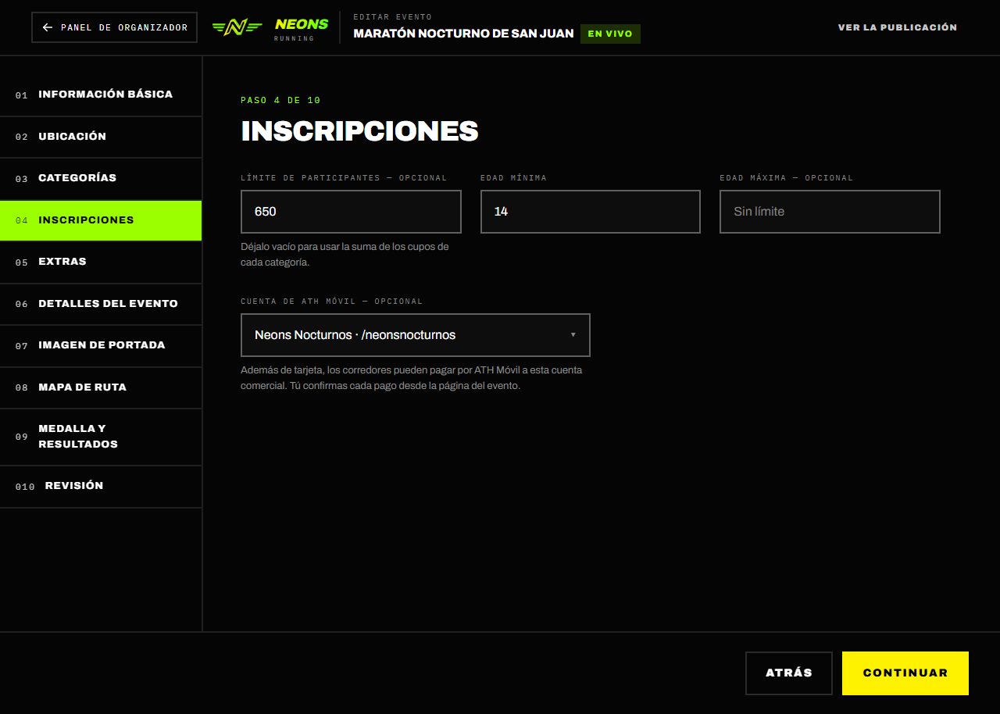

- **Límite de participantes** (opcional): el cupo total del evento. Si lo
  dejas vacío, se usa la suma de los cupos de las categorías.
- **Edad mínima** y **Edad máxima** (opcional): se comprueban con la edad del
  corredor el día de la carrera.
- **Cuenta de ATH Móvil** (opcional): la cuenta comercial a la que los
  corredores pueden pagar por ATH Móvil, además de con tarjeta. Las cuentas
  las crea el equipo de NEONS RUNNING. Si no hay ninguna, los corredores solo
  pagan con tarjeta. Elige **No aceptar ATH Móvil** para desactivarlo.
- **Cobrar IVU (11.5%)**: márcalo para que los corredores paguen el IVU de
  Puerto Rico sobre la inscripción, los extras, el cargo por servicio y el
  envío (nunca sobre el donativo). Los eventos nuevos empiezan sin marcar; los
  que existían antes de esta opción la tienen marcada. Cambiarlo solo afecta
  las inscripciones nuevas: las ya hechas conservan el IVU con que se
  calcularon.

### Paso 5 · Extras

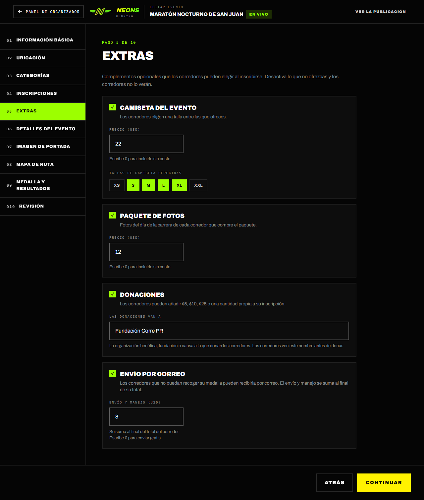

Activa solo lo que ofreces; lo que esté desactivado no lo ven los corredores.

| Extra | Qué configuras |
| --- | --- |
| **Camiseta del evento** | Precio (0 = incluida) y tallas ofrecidas (XS a XXL, al menos una) |
| **Paquete de fotos** | Precio (0 = incluido) |
| **Donaciones** | A quién van las donaciones (obligatorio si está activo). Los corredores eligen $5, $10, $25 u otra cantidad. |
| **Envío por correo** | Precio de envío y manejo del paquete (0 = gratis), que se suma al total del corredor |

### Paso 6 · Detalles del evento

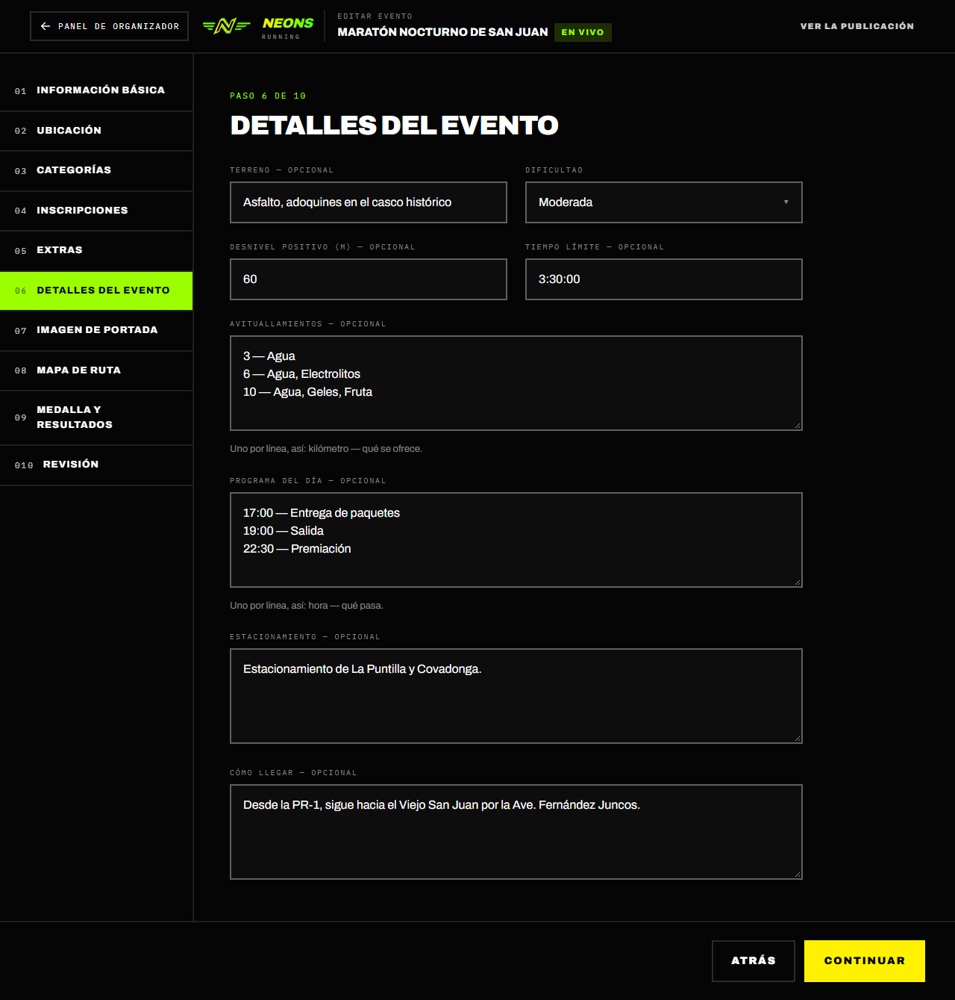

Todo es opcional salvo la **Dificultad** (Fácil, Moderada o Difícil): terreno,
desnivel positivo, tiempo límite, estacionamiento, cómo llegar y:

- **Avituallamientos**: uno por línea, así: `3 — Agua, geles`.
- **Programa del día**: uno por línea, así: `6:00 PM — Salida`.

### Pasos 7, 8 y 9 · Imágenes

| Paso | Imagen | Dónde se ve | Sin imagen |
| --- | --- | --- | --- |
| 7 · Imagen de portada | Foto del evento (mejor horizontal) | Tarjeta y página del evento | Portada genérica de NEONS |
| 8 · Mapa de ruta | Captura de Strava, Garmin o Google Maps | Pestaña **Ruta** | Un diagrama sencillo |
| 9 · Medalla y resultados | Foto o render de la medalla | Página del evento y perfil de quienes terminan | Una medalla de muestra |

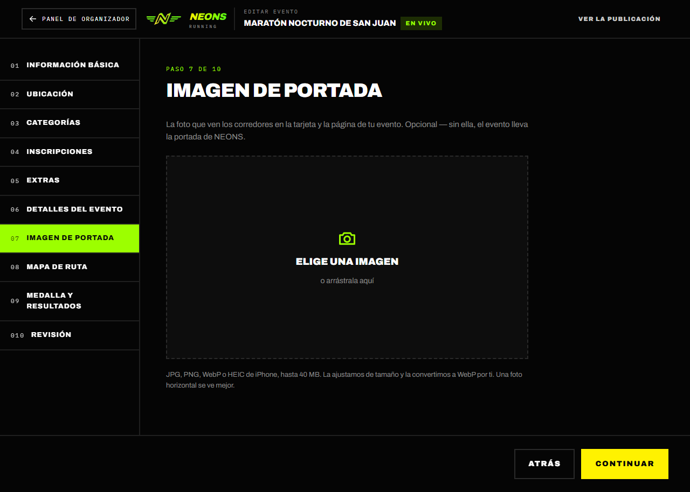

Pulsa **Elige una imagen** o arrástrala. Se aceptan JPG, PNG, WebP o HEIC de
iPhone de hasta 40 MB; la app la ajusta de tamaño y la convierte a WebP.

### Paso 9 · Medalla y resultados (opciones)

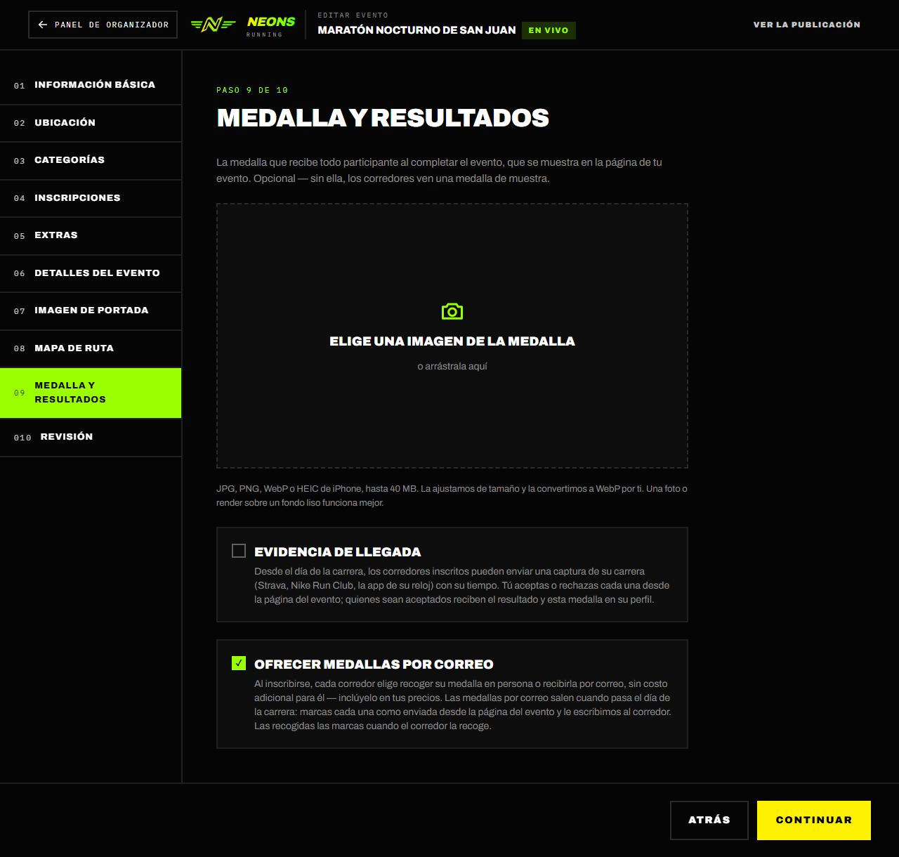

- **Evidencia de llegada**: desde el día de la carrera, los inscritos pueden
  enviar una captura con su tiempo, y tú la aceptas o la rechazas (ver
  [3.8](#38-revisar-resultados)). Es lo habitual en carreras virtuales.
- **Incluir las medallas en el envío**: quien añade **Envío por
  correo** recibe su paquete y su medalla en un solo envío, cubierto por el
  cargo de envío; los demás recogen ambos. Requiere **Envío por correo** activo
  en los extras (ver [3.6](#36-enviar-kits-y-medallas)).

### Paso 10 · Revisión y publicación

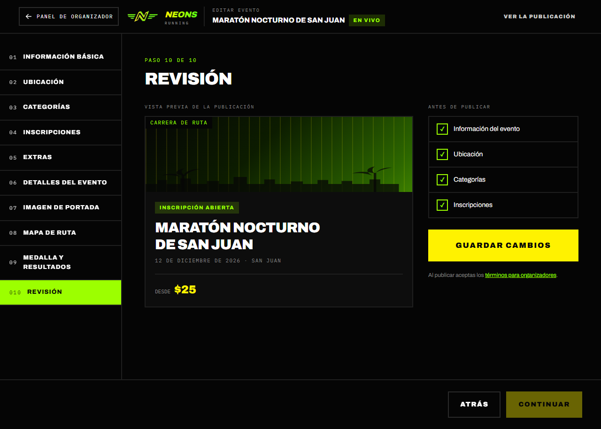

Verás una **vista previa** de la tarjeta del evento y la lista **Antes de
publicar** (información, ubicación, categorías e inscripciones). Si un paso
tiene errores, se marca en la columna izquierda.

- **Publicar evento**: el evento queda **en vivo** y aparece en **Carreras**.
  Al publicar aceptas los términos para organizadores.
- **Guardar borrador**: lo guarda sin publicarlo.

> Publicar es **definitivo**: un evento publicado no puede volver a borrador.

> **🛠 Nota técnica:** `saveEventAction` (`lib/events/actions.ts`) valida el
> formulario y llama a `save_event()`, que repite las reglas en la base de
> datos: rol de organizador, estado `draft` o `published` (nunca `removed`),
> cupos frente a inscritos y cuenta de ATH Móvil activa. Las imágenes se
> convierten a WebP en el navegador y se suben al bucket de imágenes de
> eventos dentro de la carpeta del organizador.

## 3.3 Editar o eliminar un evento

**Editar:** en **Mis eventos**, pulsa **Editar**. Se abre el mismo asistente
con los datos cargados; en un evento publicado, el botón final es **Guardar
cambios**. **Ver la publicación** (arriba a la derecha) abre la página
pública.

Si cambias la **fecha**, la **hora de salida** o el **lugar** de un evento
publicado que aún no ha pasado, los corredores confirmados reciben el correo
*"Actualización: … cambió"*.

**Eliminar:** pulsa **Eliminar** en la tarjeta o en el asistente y confirma.

- Un **borrador** se borra con todo su contenido.
- Un evento **publicado** solo se puede eliminar si **nadie ha pagado** y no
  hay pagos de ATH Móvil pendientes. Sale del listado y su enlace deja de
  funcionar.
- Ninguna eliminación se puede deshacer.

**¿Necesitas cancelar una carrera con inscritos?** El organizador no puede
hacerlo desde la app. Escribe al equipo desde **Contacto**: un administrador
la retira y avisa a los corredores (ver la
[guía del administrador](04-administrador.md#retirar-un-evento)).

## 3.4 Confirmar pagos de ATH Móvil

Los pagos con tarjeta se confirman solos. Los de **ATH Móvil** esperan a que
alguien los verifique; mientras tanto, el cupo del corredor queda guardado.

**Cuándo:** cada vez que un corredor envía un pago por ATH Móvil recibes el
correo *"Pago por ATH Móvil por revisar"*.

**Dónde:** página del evento → **Pagos pendientes**.

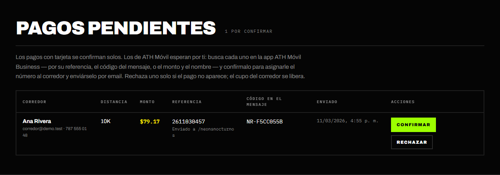

1. Abre la app **ATH Móvil Business** y busca el pago por su **Referencia**,
   por el **Código en el mensaje** (por ejemplo `NR-F5CC055B`) o por el monto
   y el nombre.
2. Si lo encuentras y el monto es correcto, pulsa **Confirmar**. El corredor
   recibe su número de dorsal y el correo de confirmación.
3. Si el pago **no aparece**, pulsa **Rechazar** y luego **Rechazar Pago**.
   El cupo se libera y el corredor recibe un correo para pagar de nuevo.

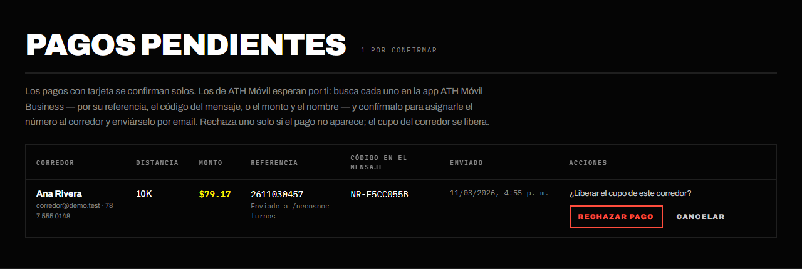

Si el pago se envió a una cuenta de ATH Móvil que no es tuya (por ejemplo, la
de NEONS RUNNING), en lugar de los botones verás *"Un administrador
confirmará este pago"*.

> **🛠 Nota técnica:** quién puede revisar un pago lo decide
> `can_review_ath_movil_payment()`: un administrador, o el organizador cuando
> la cuenta de ATH Móvil del evento es suya (`ath_movil_accounts.owner_id`).
> Los administradores tienen además la cola general `/admin/payments`. La
> acción es `reviewAthMovilPaymentAction` (`lib/ath-movil/review.ts`).

## 3.5 Gestionar las inscripciones

**Dónde:** página del evento → **Inscripciones** (o **Inscripciones (n)** en
la tarjeta del panel).

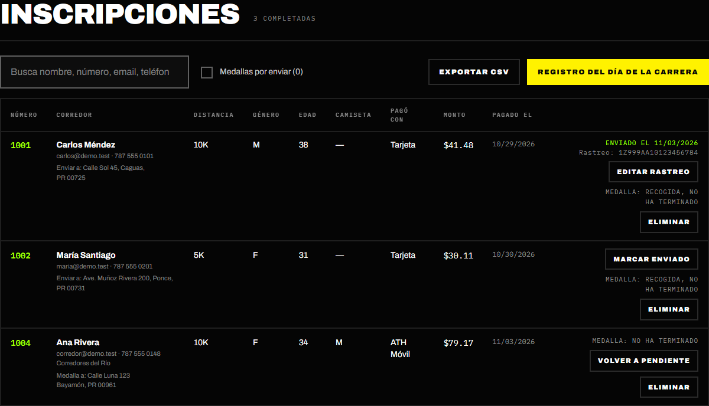

La tabla muestra solo las **inscripciones completadas** (pagadas): número de
dorsal, corredor (con correo, teléfono, club y dirección si aplica),
distancia, género, edad, camiseta, método de pago, monto y fecha de pago.

- **Buscar**: por nombre, número, correo, teléfono o club.
- **Exportar CSV**: descarga la tabla en un archivo para Excel u hojas de
  cálculo.
- **Registro del día de la carrera**: abre el check-in (ver
  [3.7](#37-check-in-el-día-de-la-carrera)). No aparece en eventos virtuales.

### Eliminar a un corredor

1. Pulsa **Eliminar** en su fila.
2. Lee el aviso y confirma con **Eliminar**.

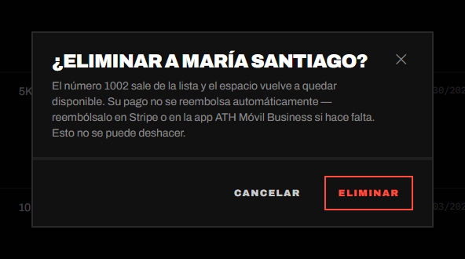

El número sale de la lista, el cupo vuelve a quedar libre y el corredor recibe
el correo *"Tu inscripción en … fue cancelada"*. **El pago no se reembolsa
automáticamente**: reembólsalo tú en Stripe o en ATH Móvil Business. No se
puede deshacer.

No se puede eliminar a un corredor cuyo resultado ya fue **aceptado** o
**descalificado**: su inscripción se conserva como registro.

Los corredores eliminados quedan en la sección desplegable **Corredores
removidos**, debajo de la tabla, con lo que pagaron y el estado del reembolso.
Los reembolsos con tarjeta hechos en Stripe aparecen solos; los de ATH Móvil
no se registran ahí.

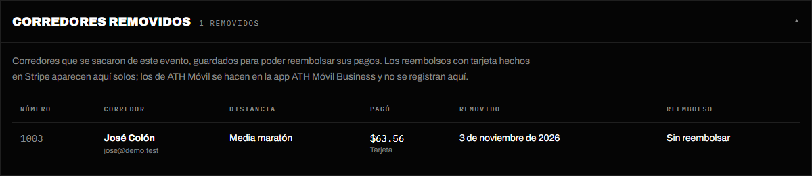

### Volver un pago de ATH Móvil a pendiente

Si confirmaste un pago de ATH Móvil por error, pulsa **Volver a pendiente** en
la fila del corredor. Su número se libera, la inscripción regresa a **Pagos
pendientes** y el corredor **conserva su cupo**. Al confirmarlo de nuevo recibe
el siguiente número disponible y un nuevo correo de confirmación.

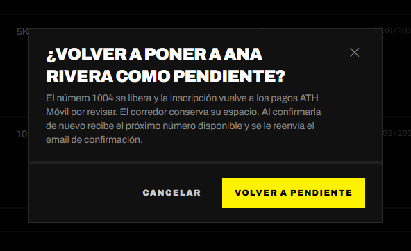

No está disponible para pagos con tarjeta, ni si el corredor ya tiene un
resultado aceptado o descalificado, ni si su paquete o medalla ya se envió o
entregó.

> **🛠 Nota técnica:** `removeRegistrationAction` y
> `returnRegistrationToPendingAction` (`lib/events/remove-registration.ts`).
> Una inscripción eliminada no se borra: pasa a `status = 'cancelled'` (el
> trigger `keep_payment_records` impide borrar filas con pago), y así queda
> disponible para los reembolsos y para `getCancelledRegistrations`. El CSV
> usa las mismas columnas que la tabla y se genera en el navegador.

## 3.6 Enviar kits y medallas

Las acciones de envío aparecen en la fila de cada corredor, dentro de
**Inscripciones**.

### El envío del corredor

Cada corredor tiene **un solo envío**, con una dirección y un número de rastreo:
su paquete (kit), su medalla o ambos. La fila muestra *"Enviar a: …"*.

1. Pulsa **Marcar enviado** y confirma. El corredor recibe el correo *"Tu envío
   de … va en camino"*. No se puede deshacer.

   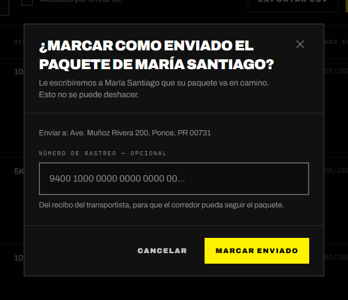

2. Opcional: pulsa **Añadir rastreo**, escribe el **Número de rastreo** del
   transportista y pulsa **Guardar rastreo**. El corredor lo ve en su perfil.
   Cambiar el rastreo después **no** le envía otro correo.

   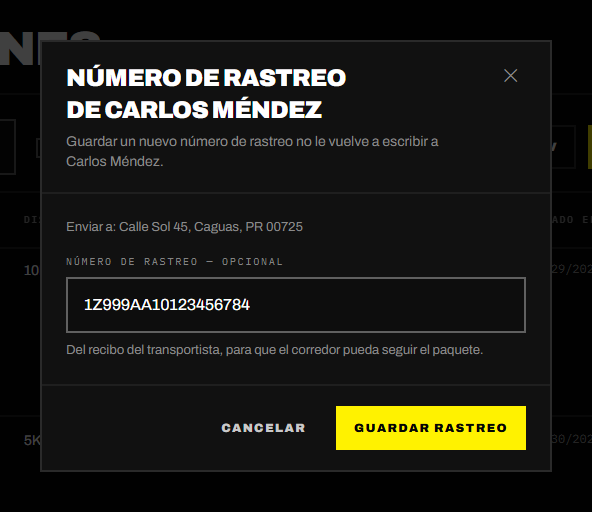

### Cuándo sale

Un envío con medalla espera a que el corredor la gane, y el paquete viaja con
ella. Un paquete sin medalla pendiente puede salir en cualquier momento.

| Lo que ves | Qué hacer |
| --- | --- |
| **Marcar enviado** | Ya puede salir. |
| *Esperando la llegada* | Todavía no se puede enviar. El corredor puede recoger su paquete en el check-in. |
| *Sin dirección* | El corredor aún no ha dado una dirección. |
| **Marcar medalla enviada** | El paquete salió antes y la medalla ya se ganó. Escribe su número de rastreo; el corredor recibe otro correo. |
| *Medalla: se recoge al terminar* | El corredor aún no ha terminado. No hay nada que hacer todavía. |
| *Medalla: por recoger* | Cuando la recoja, pulsa **Marcar recogida**. |

Si la carrera termina y el corredor no ganó la medalla, **Marcar enviado** manda
solo el paquete, para que no se quede retenido. Si la gana después, sigue como
**Marcar medalla enviada**. Un corredor descalificado recibe solo el paquete.

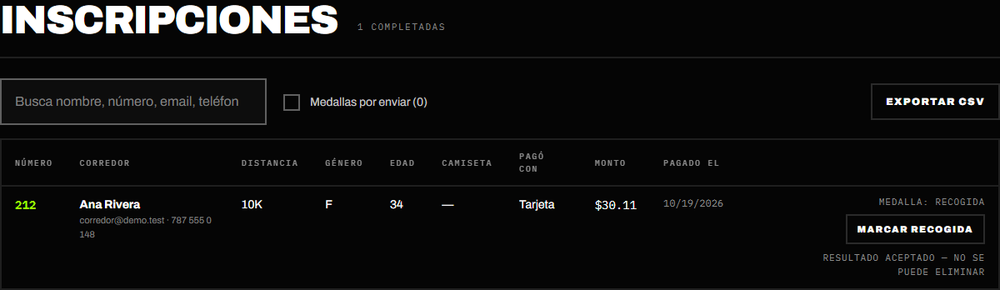

**"Terminar"** depende del evento: si acepta evidencia de llegada, cuando
aceptas su resultado; si no, cuando pasa el día de la carrera.

Marca **Envíos por hacer (n)** sobre la tabla para ver solo los envíos que ya
pueden salir.

> **🛠 Nota técnica:** `markShipmentShippedAction` y
> `markMedalPickedUpAction` (`lib/events/shipment.ts`). El correo *shipment*
> pasa por la cola de correos.

## 3.7 Check-in el día de la carrera

**Para qué sirve:** confirmar en la villa de salida que cada corredor llegó y
entregarle lo que le toca. Está pensado para usarse **en el teléfono**.

**Dónde:** página del evento → **Inscripciones** → **Registro del día de la
carrera** (`/organizer/events/<id>/checkin`). No existe en eventos virtuales ni
en los de *cualquier lugar*.

1. Escribe el **nombre o el número de dorsal** del corredor. Arriba a la
   derecha ves cuántos llevas registrados (por ejemplo *0 de 3*).

   

2. Toca al corredor. Verás su dorsal, distancia, edad y una lista de
   comprobación: **Inscripción**, **Pago**, **Camiseta · talla** y, si aplica,
   el **Paquete de carrera**.

   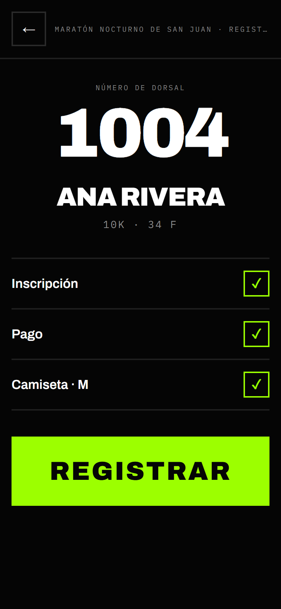

3. Toca **Registrar**. Verás **Registrado** y el aviso *"… está listo para la
   línea de salida"*. Pulsa **Siguiente corredor** para seguir, o **Deshacer
   registro** si te equivocaste.

   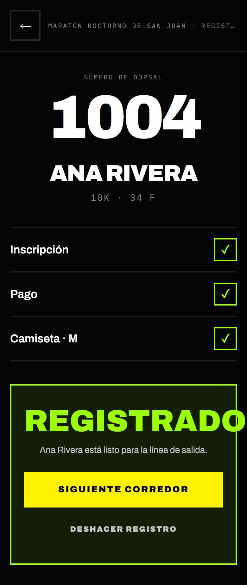

Casos especiales:

- **Pago en revisión**: un corredor con el pago de ATH Móvil sin confirmar no
  se puede registrar. Resuélvelo en la mesa con **Abrir revisión de pagos**.
- **Paquete por correo que nunca se envió**: la lista lo marca con *"Lo pidió
  por correo pero nunca se envió — entrégalo aquí"*.
- Varias personas pueden hacer check-in a la vez desde distintos teléfonos.

> **🛠 Nota técnica:** `setCheckedInAction` (`lib/events/check-in.ts`) guarda
> `registrations.checked_in_at`. Cada toque se muestra al instante y se
> guarda por detrás. La lista se recarga del servidor 15 s después del último
> toque (`REFRESH_AFTER_MS` en `components/organizer/checkin.tsx`), y esa
> recarga también trae los registros hechos desde otros teléfonos.
> `reconcileTaps` (`lib/events/check-in-station.ts`) decide qué toques siguen
> en pantalla: la lista del servidor solo gana sobre un toque guardado cuando
> ya llegó la recarga posterior a ese guardado.

## 3.8 Revisar resultados

Solo en eventos con **Evidencia de llegada** activa. Cuando un corredor envía
su resultado recibes el correo *"Resultado por revisar"*.

**Dónde:** página del evento → **Resultados por revisar**.

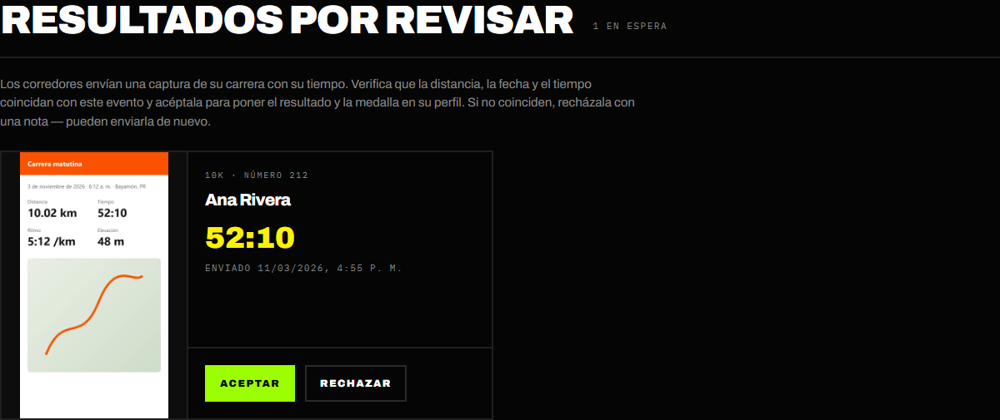

1. Abre la captura (tócala para verla en tamaño completo) y comprueba que la
   **distancia**, la **fecha** y el **tiempo** coinciden con el evento.
2. Si todo cuadra, pulsa **Aceptar**. El resultado y la medalla aparecen en
   el perfil del corredor y este recibe un correo.
3. Si no cuadra, pulsa **Rechazar**, escribe una **Nota para el corredor**
   (la verá) y pulsa **Rechazar resultado**. El corredor puede enviar nueva
   evidencia.

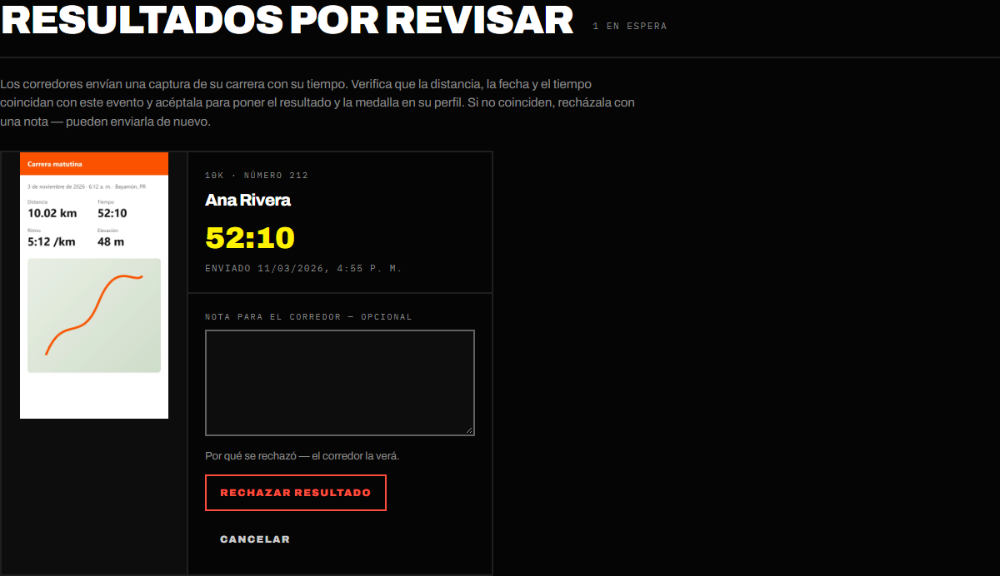

### Resultados revisados y descalificación

Debajo, **Resultados revisados** lista todo lo que revisaste: los aceptados
van del más rápido al más lento y los devueltos quedan al final. Puedes
buscar por nombre o número y abrir la **Evidencia** de cada uno.

Si un corredor hizo trampa, pulsa **Descalificar**, escribe el **Motivo** (el
corredor lo verá) y confirma con **Descalificar resultado**. El resultado y la
medalla salen de su perfil y ya no puede enviar evidencia. **Solo un
administrador puede deshacerlo.**

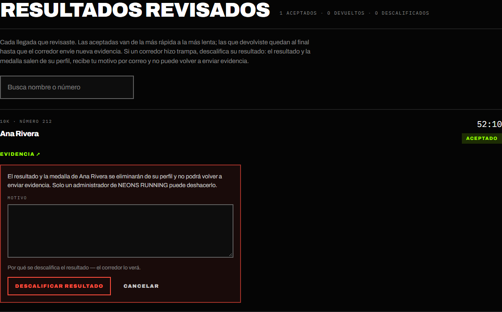

### Marcar la llegada de un corredor sin evidencia

Si un corredor no logra enviar su captura (la app de su reloj no la da, la
subida falla, su teléfono no coopera), puedes registrar su llegada tú. Está
disponible desde el día de la carrera en eventos con **Evidencia de llegada**
activa.

1. En **Inscripciones**, busca al corredor y pulsa **Marcar llegada**.
2. Escribe su **Tiempo final** (`h:mm:ss`, `mm:ss` o solo números, como
   `12541` para 1:25:41) y confirma.

El resultado queda **aceptado al momento**: aparece en su perfil y en la
clasificación con la medalla, y el corredor recibe un correo. Si tenía una
captura **en revisión** o **devuelta**, tu tiempo la reemplaza. No se puede
marcar sobre un resultado ya aceptado o descalificado. En **Resultados
revisados** aparece como *Registrado por el organizador — sin evidencia*, y
se puede descalificar como cualquier otro.

> **🛠 Nota técnica:** `reviewRaceResultAction`,
> `recordRaceResultAction` (función `record_race_result()`, con
> `evidence_path` nulo) y `disqualifyRaceResultAction`
> (`lib/results/actions.ts`).
> `reinstateRaceResultAction` (**Restablecer**) solo está disponible para
> administradores. Las capturas están en el bucket privado `race-evidence`;
> el organizador las ve mediante URLs firmadas.

## Correos que recibe el organizador

| Correo (asunto) | Cuándo llega |
| --- | --- |
| **Pago por ATH Móvil por revisar: corredor, evento** | Un corredor envió un pago por ATH Móvil a una cuenta tuya |
| **Resultado por revisar: corredor, evento** | Un corredor envió su evidencia de llegada |
| **Actualizamos …** | Un administrador editó tu evento (dice qué pasos cambiaron) |
| **… fue retirado de NEONS RUNNING** | Un administrador retiró tu evento (incluye el motivo) |
| **… volvió a NEONS RUNNING** | Un administrador restauró tu evento |

Como corredor, el organizador también recibe los correos de la
[guía del corredor](02-corredor.md#correos-que-recibe-el-corredor) de sus
propias inscripciones.

---

[← Guía del corredor](02-corredor.md) · [Índice](README.md) · [Guía del administrador →](04-administrador.md)
