# 4. Guía del administrador

[← Volver al índice](README.md)

Un **administrador** es un miembro del equipo de NEONS RUNNING que modera la
plataforma: revisa los pagos de ATH Móvil de todos los eventos, gestiona las
cuentas de ATH Móvil y puede editar, retirar o restaurar cualquier evento.

El rol de administrador es independiente del de organizador y se suma a lo que
la cuenta ya tenía: un administrador sigue siendo corredor y puede ser también
organizador.

**¿Cómo se obtiene?** Lo asigna el equipo técnico directamente en la base de
datos (ver [4.7](#47-tareas-fuera-de-la-app-equipo-técnico)). No hay forma de
pedirlo desde la app.

## Resumen: qué puede hacer un administrador

| Tarea | Dónde |
| --- | --- |
| [Revisar pagos de ATH Móvil de todos los eventos](#42-revisión-de-pagos) | **Revisión de Pagos** (`/admin/payments`) |
| [Gestionar las cuentas de ATH Móvil](#43-cuentas-de-ath-móvil) | **Administrar cuentas de ATH Móvil** (`/admin/payments/accounts`) |
| [Editar, retirar o restaurar eventos](#44-moderación-de-eventos) | **Moderación de Eventos** (`/admin/events`) |
| [Gestionar cualquier evento como su organizador](#45-gestionar-cualquier-evento) | Página del evento |
| [Restablecer un resultado descalificado](#46-restablecer-un-resultado-descalificado) | Página del evento → **Resultados revisados** |
| [Tareas fuera de la app](#47-tareas-fuera-de-la-app-equipo-técnico) | Base de datos, Stripe, correo del equipo |

> **🛠 Nota técnica:** ser administrador es tener una fila en
> `public.platform_admins`. La base de datos lo comprueba con
> `public.is_platform_admin()` y la app con `isPlatformAdmin()` /
> `requireAdmin()` (`lib/auth/session.ts`). Para quien no es administrador,
> las páginas `/admin/*` responden **404**: no revelan que existen.

---

## 4.1 Menú de administración

Con una cuenta de administrador, el menú de la cuenta tiene dos opciones
más: **Revisión de Pagos** y **Moderación de Eventos**.

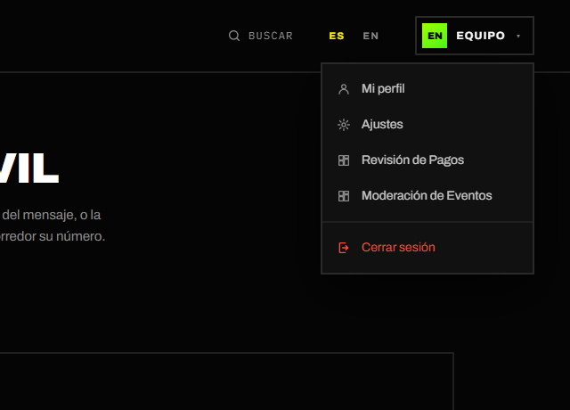

En **Ajustes** → **Tipo de cuenta** aparece además la tarjeta **Admin**.

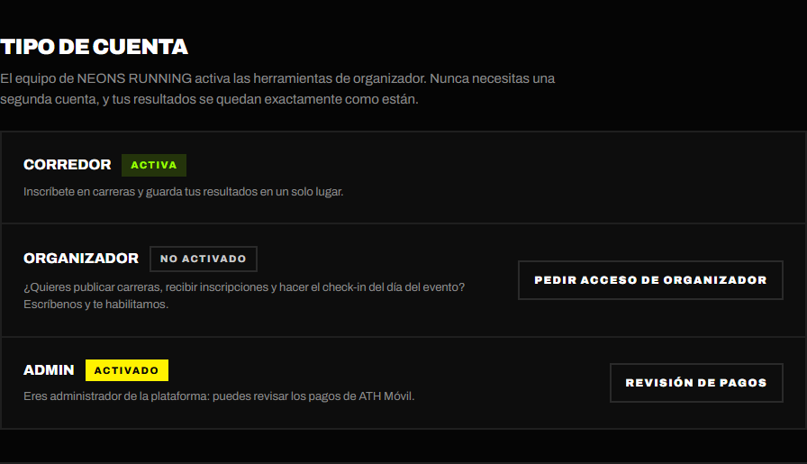

## 4.2 Revisión de pagos

**Para qué sirve:** verificar los pagos de ATH Móvil de **todos** los eventos
en una sola cola. Es imprescindible para los pagos que llegan a cuentas **sin
dueño** (por ejemplo, la de NEONS RUNNING), que los organizadores no pueden
aprobar. También sirve de respaldo si un organizador no revisa sus pagos.

**Dónde:** menú → **Revisión de Pagos** (`/admin/payments`).

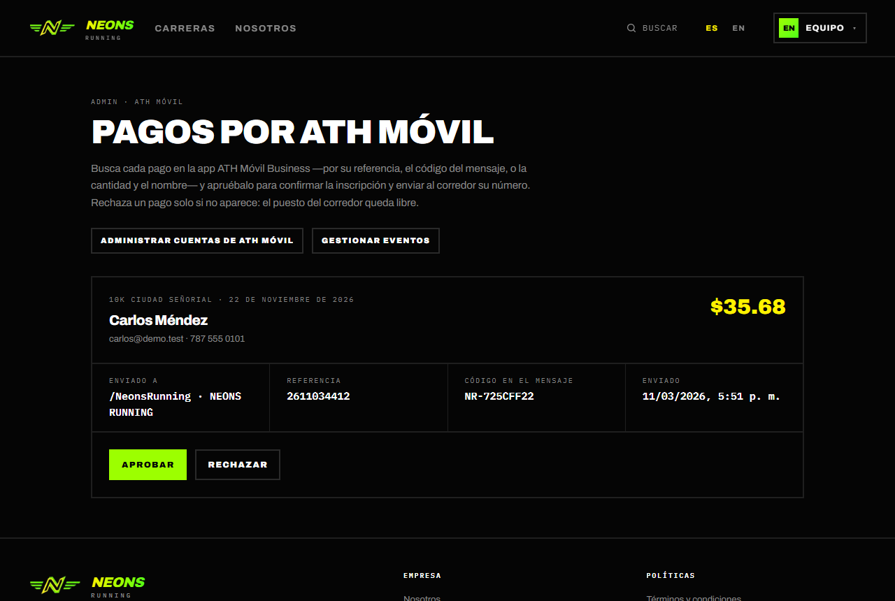

Cada pago muestra el evento, el corredor, el monto, la cuenta a la que se
envió (**Enviado a**), la **Referencia**, el **Código en el mensaje** y la
fecha.

1. En la app **ATH Móvil Business** de esa cuenta, busca el pago por su
   referencia, por el código del mensaje o por el monto y el nombre.
2. Si aparece y el monto es correcto, pulsa **Aprobar**. La inscripción se
   confirma y el corredor recibe su número por correo.
3. Si no aparece, pulsa **Rechazar** y confirma con **Rechazar Pago**. El cupo
   se libera y el corredor recibe un correo para pagar de nuevo.

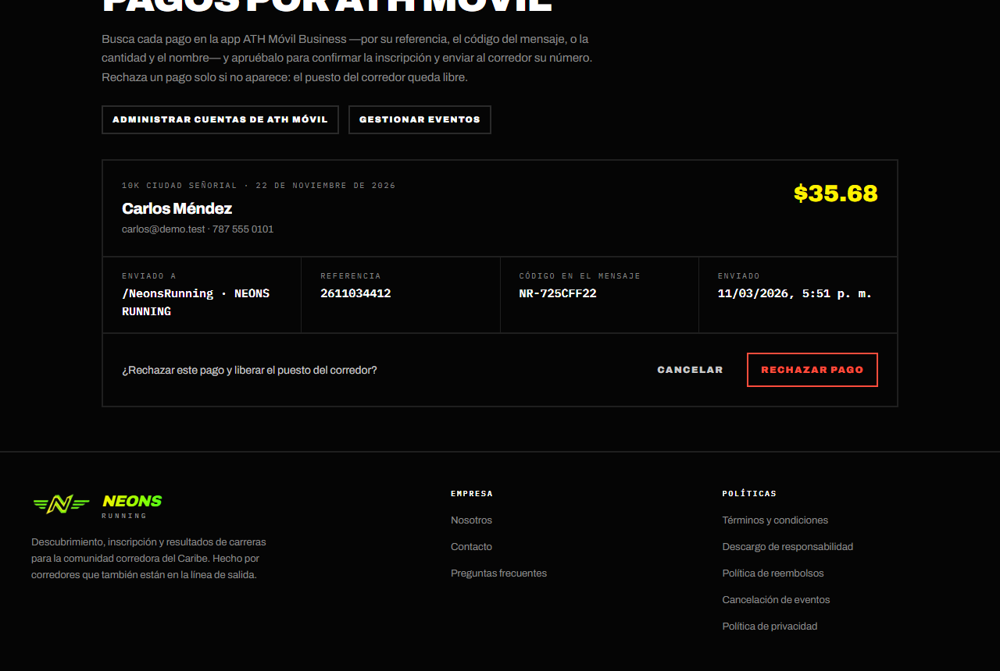

Cuando no queda nada pendiente, la página dice *"No hay pagos pendientes de
revisión"*. Si otra persona ya revisó el pago (por ejemplo, el organizador),
verás *"Alguien ya revisó este pago"*.

> **🛠 Nota técnica:** misma acción que la del organizador,
> `reviewAthMovilPaymentAction` (`lib/ath-movil/review.ts`). Los
> administradores **no** reciben el correo *Pago por ATH Móvil por revisar*;
> revisan desde esta cola.

## 4.3 Cuentas de ATH Móvil

**Para qué sirve:** definir a qué cuentas de **ATH Móvil Business** pueden
pagar los corredores. Cada organizador elige una de estas cuentas en el paso
**Inscripciones** del asistente de su evento.

**Dónde:** **Revisión de Pagos** → **Administrar cuentas de ATH Móvil**
(`/admin/payments/accounts`).

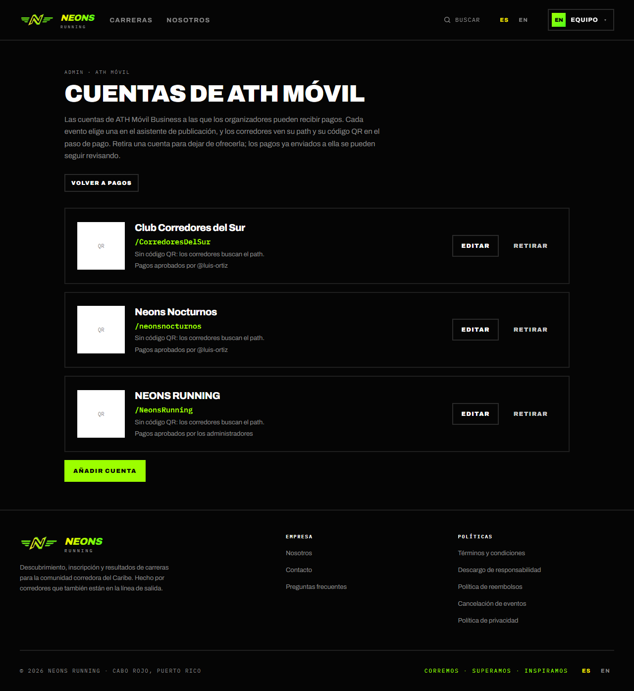

### Añadir o editar una cuenta

1. Pulsa **Añadir cuenta** (o **Editar** en una existente).
2. Completa:
   - **Nombre**: lo que ven los organizadores al elegir la cuenta (hasta 80
     caracteres).
   - **Path del negocio**: tal como los corredores lo buscan en ATH Móvil,
     por ejemplo `/NeonsRunning`. No puede repetirse.
   - **Dueño** (opcional): el usuario del organizador que tiene esa app de
     negocio. Escríbelo (por ejemplo `@luis-ortiz`), pulsa **Buscar** y
     comprueba el nombre que aparece (*"Se asignará a …"*). El dueño puede
     aprobar los pagos que entren en esa cuenta **para sus propios eventos**.
     Si lo dejas vacío, solo los administradores revisan esos pagos.
   - **Código QR** (opcional): el QR exportado desde ATH Móvil Business (PNG,
     JPG o WebP, hasta 2 MB). Los corredores lo escanean en el paso de pago;
     sin él, buscan el path.
3. Pulsa **Guardar cuenta**.

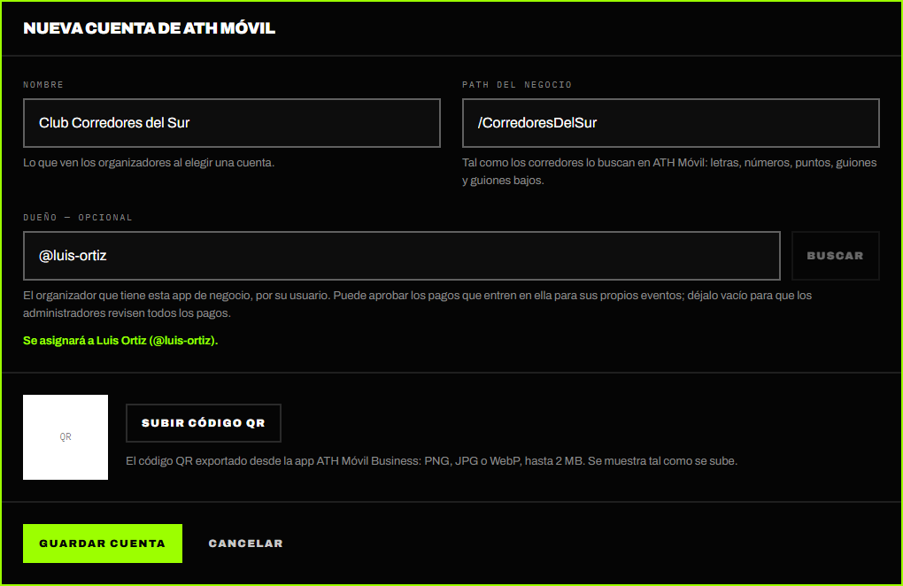

El dueño tiene que ser una cuenta de **organizador**; si no lo es, verás
*"Esa cuenta no es de organizador"*.

### Retirar o restaurar una cuenta

Pulsa **Retirar** para dejar de ofrecer una cuenta. Los eventos que la usaban
pasan a aceptar **solo tarjeta** hasta que su organizador elija otra, y los
pagos ya enviados a ella se pueden seguir revisando. **Restaurar** la vuelve a
ofrecer.

> **🛠 Nota técnica:** tabla `ath_movil_accounts` (`label`, `path`,
> `qr_path`, `active`, `owner_id`). Las escrituras pasan por
> `lib/ath-movil/accounts.ts`, y la seguridad a nivel de fila de la tabla
> rechaza a cualquiera que no sea administrador. El dueño se guarda por **id**,
> no por usuario, para que un cambio de usuario entre la búsqueda y el
> guardado no lo redirija. Los QR van al bucket `ath-movil-qr`.

## 4.4 Moderación de eventos

**Para qué sirve:** editar el evento de cualquier organizador, o **retirar**
uno que su organizador ya no puede eliminar porque hay corredores que pagaron.

**Dónde:** menú → **Moderación de Eventos** (`/admin/events`).

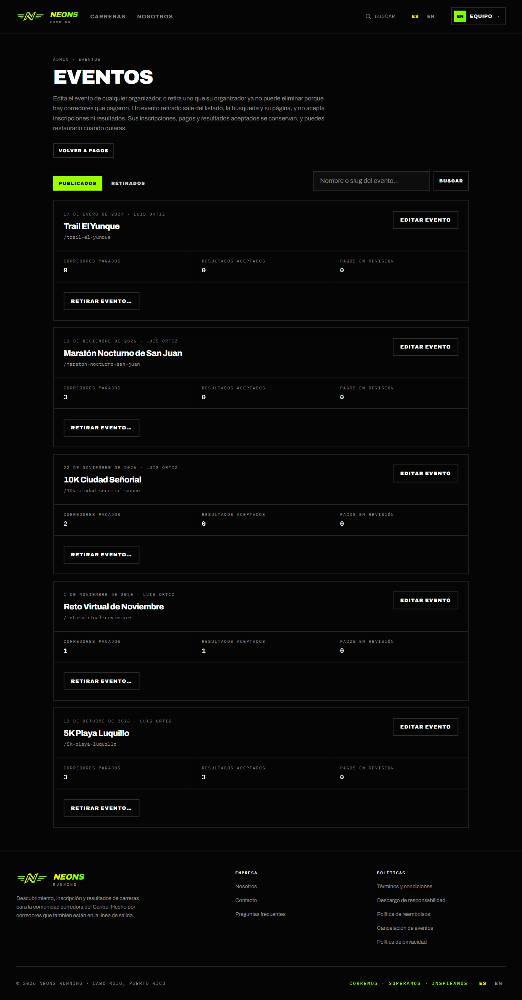

Arriba eliges entre **Publicados** y **Retirados**, y puedes buscar por
nombre o slug. Cada evento muestra su fecha, su organizador, los
**Corredores pagados**, los **Resultados aceptados** y los **Pagos en
revisión**.

### Editar un evento

Pulsa **Editar Evento**. Se abre el mismo asistente que usa el organizador
(ver la [guía del organizador](03-organizador.md#32-crear-y-publicar-un-evento)),
marcado como **Editando como admin**. Al guardar, el organizador recibe el
correo *"Actualizamos …"* con los pasos que cambiaron. Si cambias la fecha,
la hora o el lugar, los corredores también reciben su aviso.

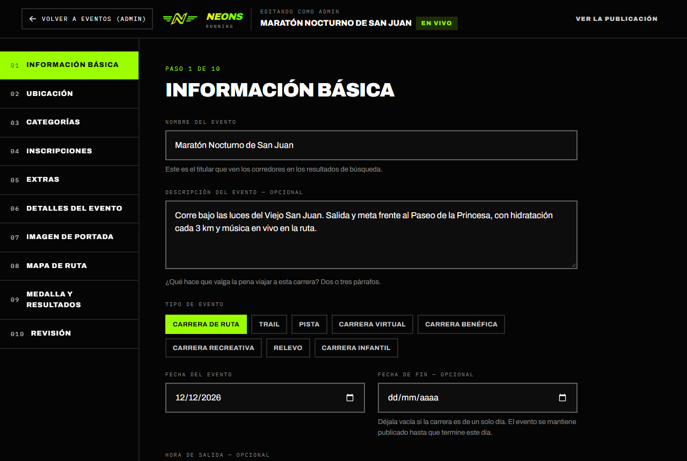

### Retirar un evento

1. Pulsa **Retirar Evento…**.
2. Escribe el **Motivo** (hasta 500 caracteres). Se envía al organizador y
   queda en el registro de moderación.
3. Escribe el **nombre exacto del evento** para confirmar.
4. Pulsa **Retirar Evento**.

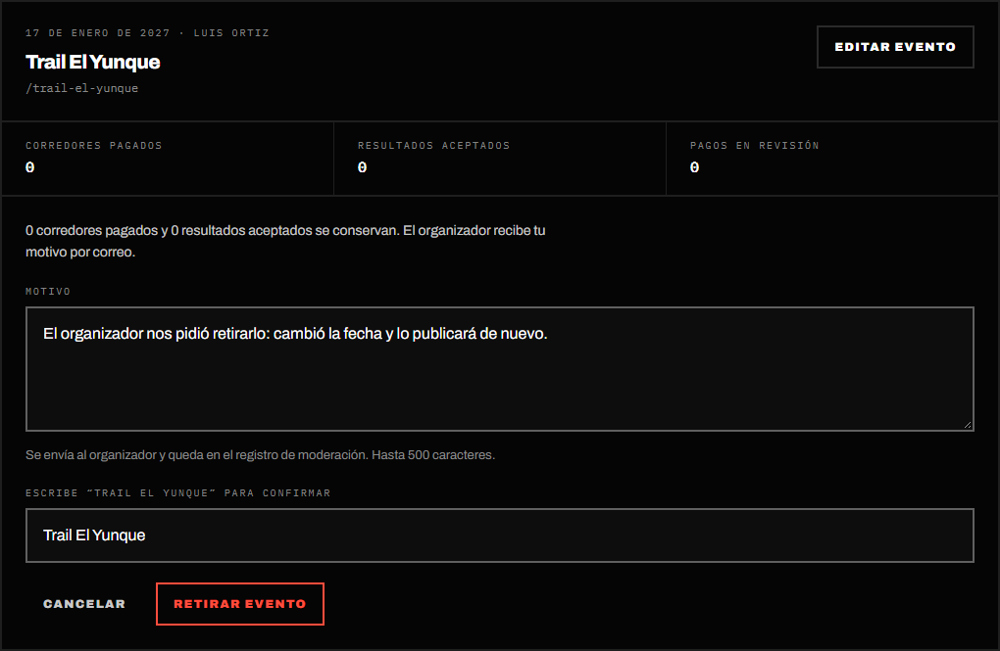

Qué pasa al retirar un evento:

- Sale del listado, de la búsqueda y de su página, y deja de aceptar
  inscripciones y resultados.
- Sus inscripciones, pagos y resultados aceptados **se conservan**. Los
  corredores mantienen sus resultados en su perfil.
- El organizador recibe *"… fue retirado de NEONS RUNNING"* con tu motivo.
- **Si la carrera aún no se ha corrido, retirarla equivale a cancelarla:**
  los corredores pagados reciben *"… fue cancelado"*. **Los reembolsos no son
  automáticos**: hazlos en Stripe o en ATH Móvil, o coordínalos con el
  organizador. El formulario te lo recuerda con cuántos corredores pagaron.
- Si la carrera ya pasó, solo se oculta; no se escribe a los corredores.

**No se puede retirar** un evento con pagos de ATH Móvil en revisión. Primero
apruébalos o recházalos (el botón **Revisar Pagos** lleva a la cola).

### Restaurar un evento

1. Cambia a **Retirados**. Cada evento muestra cuándo se retiró y el motivo.
2. Pulsa **Restaurar…** y confirma con **Restaurar Evento**.

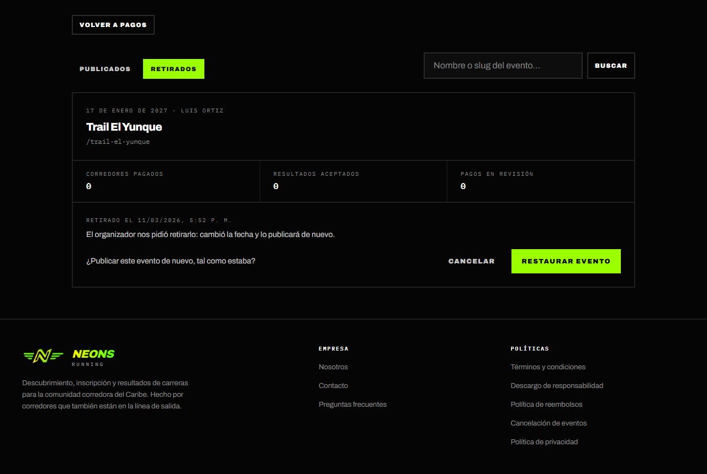

El evento se publica de nuevo tal como estaba. El organizador recibe *"…
volvió a NEONS RUNNING"* y, si la carrera aún no ha pasado, los corredores
reciben *"Buenas noticias: … va de nuevo"*.

> **🛠 Nota técnica:** `removeEventAction` y `restoreEventAction`
> (`lib/events/moderation.ts`) llaman a `admin_remove_event()` y
> `admin_restore_event()`, que vuelven a comprobar el rol y escriben en
> `event_moderation_log` (evento, nombre, slug, acción, motivo, quién y
> cuándo). Ese registro sobrevive aunque el evento se borre y solo lo leen
> administradores. Retirar pone `events.status = 'removed'`, un estado que
> `save_event()` nunca permite asignar.

## 4.5 Gestionar cualquier evento

En la página de **cualquier** evento, un administrador ve las mismas
secciones privadas que su organizador y puede usar sus herramientas:
**Pagos pendientes**, **Inscripciones** (eliminar, volver a pendiente, envíos
de kits y medallas, exportar CSV), **Resultados por revisar**, **Resultados
revisados** y el **Registro del día de la carrera**. Todo funciona igual que en
la [guía del organizador](03-organizador.md#35-gestionar-las-inscripciones).

## 4.6 Restablecer un resultado descalificado

Cuando un organizador descalifica un resultado, solo un administrador puede
deshacerlo (por ejemplo, si el corredor demuestra que fue un error).

1. Abre la página del evento y ve a **Resultados revisados**.
2. Busca el resultado marcado **Descalificado**; verás el motivo y la fecha.
3. Pulsa **Restablecer**. El resultado y la medalla vuelven al perfil del
   corredor.

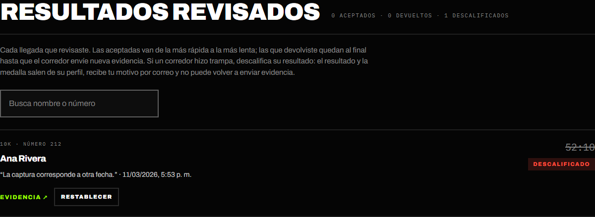

> **🛠 Nota técnica:** `reinstateRaceResultAction`
> (`lib/results/actions.ts`). El botón solo se muestra cuando el componente
> recibe `isAdmin`.

## 4.7 Tareas fuera de la app (equipo técnico)

Estas tareas no tienen pantalla en la app. Se hacen en la base de datos
(Supabase → SQL Editor), en Stripe o en la bandeja del equipo. Las consultas
de SQL de abajo usan el **usuario** (`handle`) de la persona, que aparece en
la dirección de su perfil público.

### Activar o quitar el rol de organizador

Cuando alguien pide acceso de organizador (llega por el formulario de
contacto):

```sql
-- Activar
update public.profiles set account_type = 'organizer' where handle = 'luis-ortiz';

-- Quitar
update public.profiles set account_type = 'runner' where handle = 'luis-ortiz';
```

Al quitar el rol, sus eventos siguen publicados, pero el organizador ya no
puede crear ni editar eventos.

### Dar o quitar el rol de administrador

```sql
-- Dar
insert into public.platform_admins (user_id)
select id from public.profiles where handle = 'equipo-neons';

-- Quitar
delete from public.platform_admins
where user_id = (select id from public.profiles where handle = 'equipo-neons');
```

### Solicitudes de borrado de cuenta

Cuando un corredor pide borrar su cuenta desde **Ajustes**, el equipo recibe
el correo *"Solicitud de borrado de cuenta: nombre"*. Si la retira, llega
*"Solicitud de borrado retirada"*. Para ver las pendientes:

```sql
select p.handle, p.full_name, r.requested_at, r.team_notified_at
from public.account_deletion_requests r
join public.profiles p on p.id = r.user_id
order by r.requested_at;
```

El borrado se hace **a mano y a propósito**. Borrar el usuario de
autenticación borraría en cascada sus inscripciones, y una inscripción pagada
es un registro de pago que hay que conservar (y quizá un reembolso
pendiente). Decide por cuenta qué se borra y qué se anonimiza, según la
política de privacidad, y **elimina la fila de `account_deletion_requests`**
al terminar.

### Reembolsos

| Método | Dónde se hace | Qué registra la app |
| --- | --- | --- |
| **Tarjeta** | Panel de **Stripe** | El webhook guarda el monto reembolsado (lo ves en **Corredores removidos**). Un reembolso **total** (o una disputa que gana el corredor) **cancela la inscripción sola**, salvo que ya tenga un resultado aceptado o descalificado. Los parciales no cambian la inscripción. La app **no** escribe al corredor: avísale tú. |
| **ATH Móvil** | App **ATH Móvil Business** | Nada: en **Corredores removidos** aparece como *No registrado*. |

### Mensajes de contacto

El formulario de **Contacto** envía cada mensaje a la bandeja `CONTACT_EMAIL`
(o al remitente de Brevo si no está configurada), con *Reply-To* del
remitente. Los correos del equipo sobre borrado de cuentas van a la misma
bandeja.

### Registro de moderación

```sql
select created_at, action, event_name, reason
from public.event_moderation_log
order by created_at desc;
```

## Correos que recibe el administrador

Como administrador, ninguno. Los avisos para el equipo (contacto y borrado de
cuentas) llegan a la bandeja del equipo, no a la cuenta del administrador.
Como corredor u organizador recibe los correos de esos roles.

---

[← Guía del organizador](03-organizador.md) · [Índice](README.md) · [Guía del visitante →](05-visitante.md)
