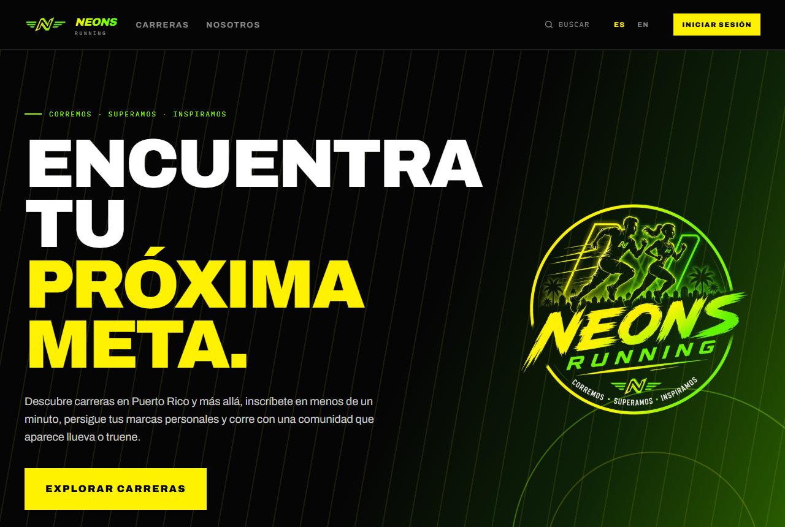
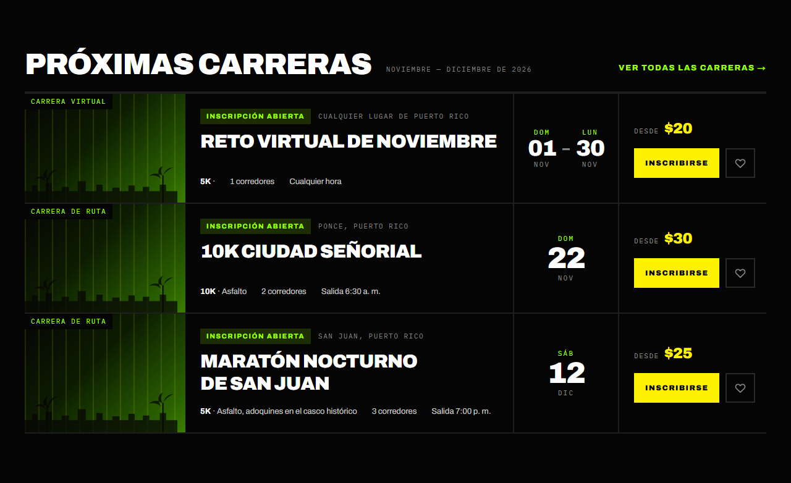
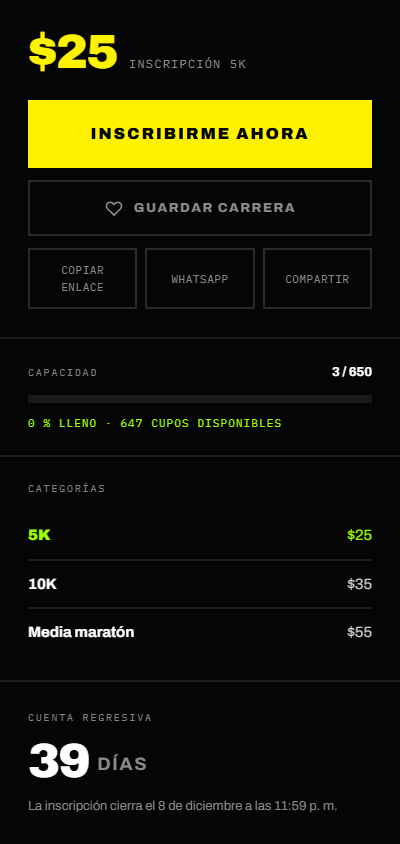
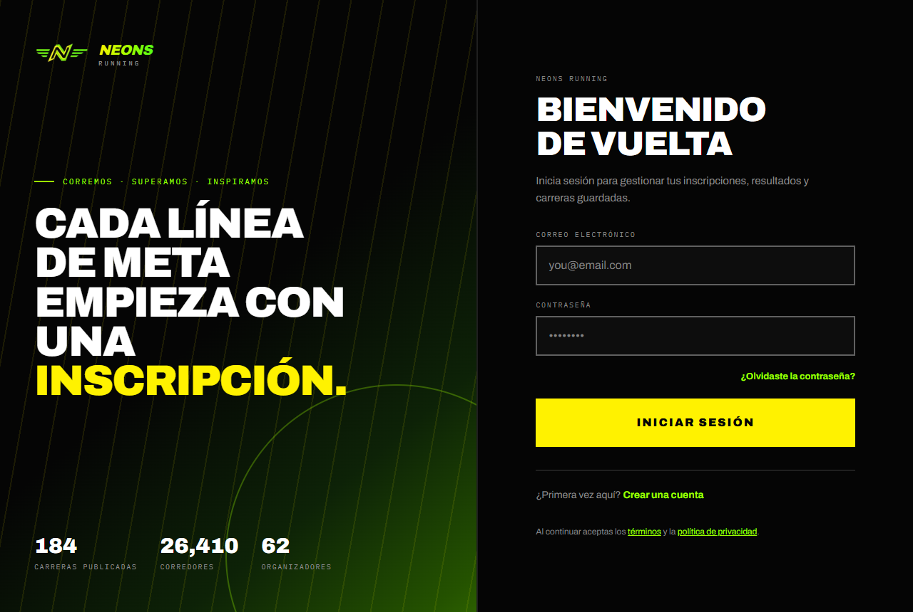
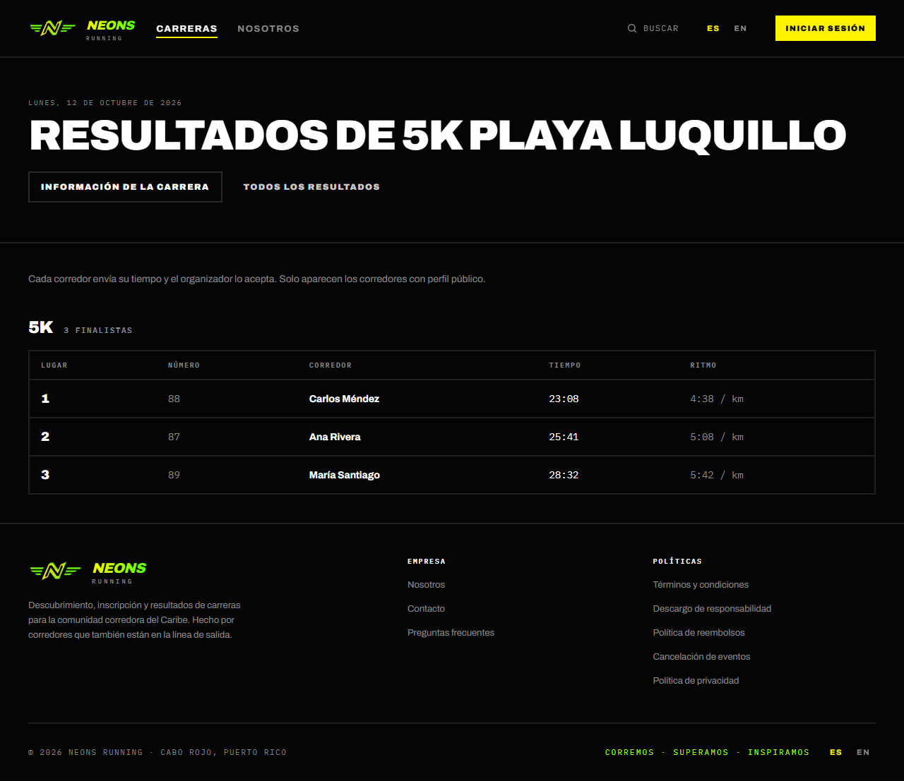
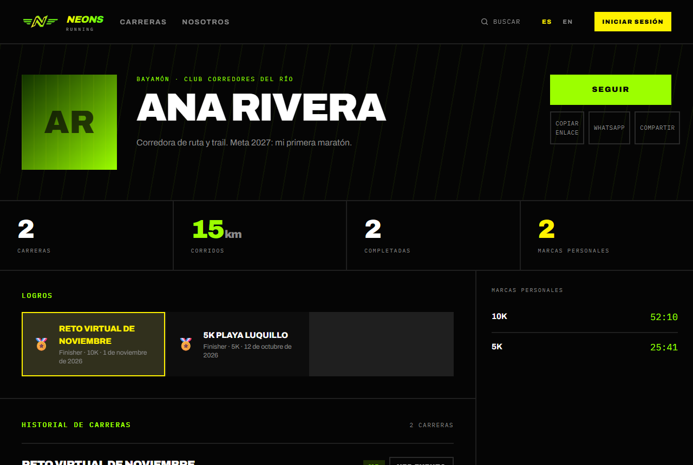
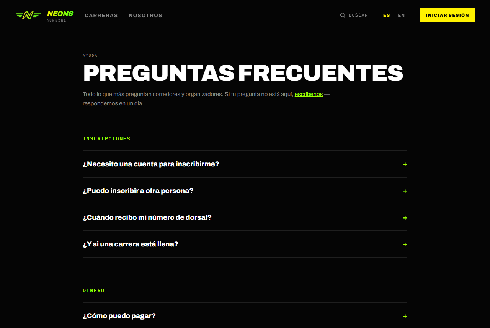
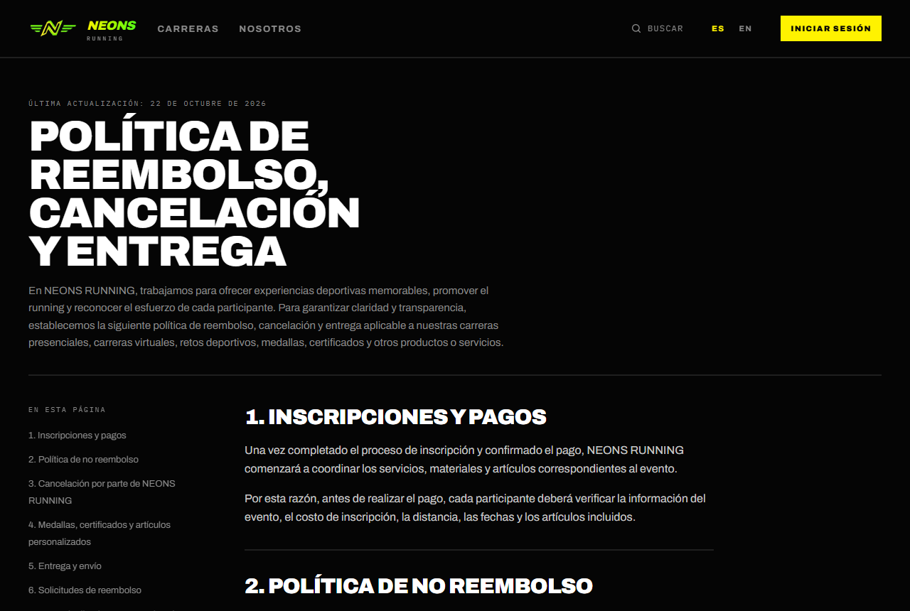
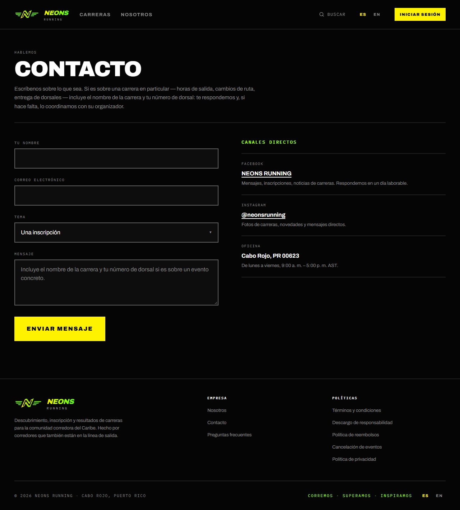
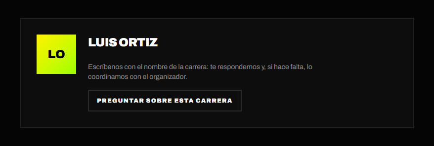

# 5. Guía del visitante

[← Volver al índice](README.md)

Un **visitante** es cualquier persona que entra a NEONS RUNNING **sin iniciar
sesión**. Puede explorar casi todo el sitio. Para inscribirse, guardar
carreras o tener un perfil hace falta una cuenta (ver
[Primeros pasos](01-primeros-pasos.md#11-crear-una-cuenta)).

## Resumen: qué puede hacer un visitante

| Tarea | Dónde | ¿Necesita cuenta? |
| --- | --- | --- |
| [Ver la portada](#51-portada) | `/` | No |
| [Buscar carreras y ver su detalle](#52-buscar-y-ver-carreras) | **Carreras** (`/events`) | No |
| [Compartir una carrera](#53-compartir-una-carrera) | Página de la carrera | No |
| [Ver resultados oficiales](#54-resultados-oficiales) | `/results`, `/events/<carrera>/results` | No |
| [Ver perfiles públicos de corredores](#55-perfiles-públicos) | `/runners/<id>` | No |
| [Leer información y políticas](#56-información-ayuda-y-políticas) | **Nosotros**, **Preguntas frecuentes**, pie de página | No |
| [Escribir al equipo](#57-contacto) | **Contacto** (`/contact`) | No |
| Inscribirse, guardar carreras, enviar resultados | — | **Sí** → [Guía del corredor](02-corredor.md) |

---

## 5.1 Portada

**Dónde:** `/` (el logo de NEONS RUNNING lleva aquí desde cualquier página).

- **Explorar carreras** abre el buscador.
- Las cifras de la plataforma: carreras publicadas, corredores, organizadores
  y clubes.
- **Próximas carreras**: las cinco más cercanas, con enlace a todas.

## 5.2 Buscar y ver carreras

El buscador y la página de cada carrera funcionan igual con o sin sesión.
Están explicados en la guía del corredor:

- [Buscar carreras](02-corredor.md#21-buscar-carreras): búsqueda, filtros,
  orden, lista y mapa.
- [Ver el detalle de una carrera](02-corredor.md#22-ver-el-detalle-de-una-carrera):
  pestañas, categorías, capacidad y estado de la inscripción.

Si un visitante pulsa **Inscribirme ahora** o **Guardar carrera** (el
corazón), la app le pide **iniciar sesión** o crear una cuenta. Después lo
**devuelve a la misma carrera** para que siga donde estaba.

> **🛠 Nota técnica:** las rutas que exigen sesión (`/runners/me`,
> `/notifications`, `/organizer`, `/admin`, `/publish`) y la inscripción de un
> evento real envían a `/login?next=<ruta>`. El botón de guardar hace lo mismo
> desde el navegador (`components/events/saved-events.tsx`). Ver
> `lib/auth/routes.ts`.

## 5.3 Compartir una carrera

En la página de cada carrera, debajo de **Guardar carrera**:

- **Copiar enlace**: copia la dirección de la carrera.
- **WhatsApp**: abre WhatsApp con el enlace listo para enviar.
- **Compartir**: abre el menú de compartir del teléfono o del navegador.

Al compartir el enlace en redes o en mensajería, se muestra una tarjeta de
vista previa de la carrera.

> **🛠 Nota técnica:** las imágenes de vista previa se generan en
> `/api/og/events/[slug]` (y `/api/og` para el sitio). Las páginas de carreras
> están en `sitemap.ts`; los perfiles de corredores llevan `noindex`.

## 5.4 Resultados oficiales

**Dónde:**

- `/results`: lista las carreras que ya tienen resultados. Por ahora **no
  aparece en el menú**; se llega por enlace directo.
- `/events/<carrera>/results`: los resultados de una carrera. Se llega desde
  **Ver resultados** en el historial de un perfil.

Cada distancia muestra cuántos finalistas tiene y una tabla con **Lugar**,
**Número**, **Corredor**, **Tiempo** y **Ritmo**, del más rápido al más lento.

- Solo aparecen los tiempos que el organizador **aceptó**.
- Solo aparecen los corredores con **perfil público** (ver
  [Ajustes → Privacidad](02-corredor.md#29-ajustes-de-la-cuenta)).

## 5.5 Perfiles públicos

**Dónde:** `/runners/<id>`; por ejemplo, al pulsar el nombre de un corredor.

Un visitante ve el nombre, la foto, la ciudad, el club, la biografía, las
estadísticas, los logros (medallas) y el historial de carreras. **No ve** las
inscripciones próximas, las carreras guardadas, los envíos ni los datos
privados del corredor.

Si el corredor desactivó **Perfil público**, el visitante ve *"Corredor no
encontrado"*.

> **🛠 Nota técnica:** la seguridad a nivel de fila de `profiles` solo
> devuelve perfiles con `is_public = true` (o el propio), así que un perfil
> privado responde 404. Las secciones privadas solo se consultan cuando quien
> mira es el dueño (`isSelf`).

## 5.6 Información, ayuda y políticas

| Página | Dónde | Contenido |
| --- | --- | --- |
| **Nosotros** | Menú superior (`/about`) | Quiénes son NEONS RUNNING |
| **Preguntas frecuentes** | Pie de página (`/faq`) | Cuatro grupos: Inscripciones, Dinero, Día de la carrera y resultados, y Organizadores |
| **Políticas** | Pie de página (`/legal/<documento>`) | Términos y condiciones, Descargo de responsabilidad, Política de reembolsos, Cancelación de eventos y Política de privacidad |

Hay además un sexto documento, **Términos para organizadores**
(`/legal/organizer-terms`), que no está en el pie de página. Se enlaza desde
el último paso del asistente para publicar eventos.

## 5.7 Contacto

**Dónde:** pie de página → **Contacto** (`/contact`). No necesita cuenta.

1. Escribe **Tu nombre** y tu **Correo electrónico** (ahí te responden).
2. Elige el **Tema**: Una inscripción, Un reembolso, Resultados de carrera,
   Publicar un evento u Otra cosa.
3. Escribe el **Mensaje**. Si es sobre una carrera, incluye su nombre y tu
   número de dorsal.
4. Pulsa **Enviar mensaje**.

**¿Una pregunta sobre una carrera concreta?** También se escribe aquí. En la
pestaña **Organizador** de cada carrera, el botón **Preguntar sobre esta
carrera** trae a este formulario: los organizadores no publican su correo, así
que el equipo responde y, si hace falta, lo coordina con el organizador.

Al enviar, verás *"Mensaje enviado"*. El equipo responde en un día laborable. A la
derecha están los **canales directos**: Facebook, Instagram y la oficina en
Cabo Rojo (lunes a viernes, 9:00 a. m. – 5:00 p. m.).

Si envías varios mensajes seguidos, el formulario pide esperar una hora.

> **🛠 Nota técnica:** `lib/contact/actions.ts` envía el mensaje con Brevo a
> `CONTACT_EMAIL` (o al remitente de Brevo), con *Reply-To* del visitante, y
> tiene límite de frecuencia. Sin Brevo configurado, el formulario responde
> *"El formulario de contacto no está disponible ahora"*. En la pestaña
> **Organizador**, el botón muestra **Contactar al organizador** con un enlace
> `mailto:` solo si el organizador tiene un correo público. En los eventos
> publicados desde `/publish` ese correo no se expone (está en
> `profile_private`), así que el botón dice **Preguntar sobre esta carrera** y
> lleva a `/contact` (`components/events/event-detail-tabs.tsx`).

## 5.8 Idioma

El selector **ES / EN** del menú superior (o del pie de página en el teléfono)
cambia todo el sitio entre español e inglés, también sin sesión (ver
[Primeros pasos](01-primeros-pasos.md#idioma)).

---

[← Guía del administrador](04-administrador.md) · [Índice](README.md) · [Correos y notificaciones →](06-correos.md)
